<div align="center">

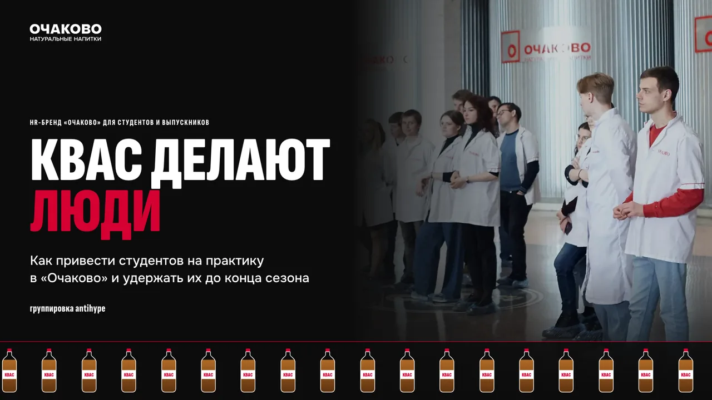

# Квас делают люди

**HR-бренд «Очаково» для студентов и выпускников 18–26 лет.** Сайт с играми и заявкой, бот Квасыча для Telegram и MAX, HR-панель для отдела персонала и всё для кампании: концепция, листовки, стенд, мерч, стикеры, ролики.

Решение команды **группировка antihype** на кейс «Открой#Моспром» от АО МПБК «Очаково».

[**Открыть сайт**](https://antihype.best) · [**Все материалы кейса**](https://antihype.best/materials) · [**Презентация**](https://antihype.best/materials/deck/index.html) · [**PDF презентации**](docs/brand/deck/ochakovo-smena.pdf) · [**HR-панель**](https://antihype.best/hr)

Вход в HR-панель: почта `jury@antihype.best`, пароль `jury-antihype`

</div>

<br>

## Коротко

«Очаково» знают по квасу, а как работодателя почти не знают. Экскурсии, музей, инженерные классы, вузы и ярмарки работают каждый сам по себе. В сезон штат линии розлива, лаборатории, технологического цеха и склада нужно увеличить в разы, а 38% новичков уходят на испытательном сроке.

Мы показываем людей, которые делают квас, и зовём молодых учиться у них. Всем точкам контакта даём одну фразу «Квас делают люди», одну сумму и один путь: QR, сайт или бот, заявка, HR-панель. У каждой точки своя метка, поэтому видно, сколько людей она привела на смену и сколько стоил один выход.

| **56 000–70 000 ₽** | **2 минуты** | **20 секунд** | **1 движок** |
|:---:|:---:|:---:|:---:|
| сумма видна на первом экране | на заявку, без резюме | игра «Поймай брак» на линии розлива | для сайта, Telegram и MAX |

<br>

## Содержание

1. [Ссылки: что открыть и где](#links)
2. [Задача и что мы сделали](#task)
3. [Концепция HR-бренда](#concept)
   - [Идея, цель и слоган](#idea) · [Одна система вместо разовых ярмарок](#system) · [Ключевые образы](#images) · [Что говорим каждой группе](#messages) · [Фокус-группа](#focus)
4. [Сайт для кандидата](#site)
   - [Первый экран и задания](#site-start) · [Знакомство с заводом](#site-company) · [Заявка и что с ней дальше](#site-apply) · [Что ещё есть на сайте](#site-more) · [Путь кандидата](#path)
5. [Квасыч: бот, помощник, маскот](#kvasych)
   - [Мост в мессенджеры](#bridge)
6. [HR-панель](#hr)
7. [Визуальные материалы: листовки и стенд](#print)
8. [Мерч](#merch)
9. [Стикерпак для Telegram](#stickers)
10. [Легенда «Квас делают люди»](#legend)
11. [Видеоролики о компании](#video)
12. [Обоснование: исследования и правила завода](#rationale)
13. [Аналоги и что придумали сами](#analogs)
14. [Второстепенные проблемы](#secondary)
15. [Разработка и внедрение](#build)
   - [Как устроено и почему так](#arch) · [Сколько стоит и что нужно от компании](#launch)
16. [Масштабируемость решения](#scale)
17. [Критерии оценки: где ответ](#criteria)
18. [Требования кейса: где в продукте](#requirements)
19. [Что работает без ключей и что нужно для запуска](#keys)
20. [Что согласовать с «Очаково»](#agree)
21. [Что дальше](#next)
22. [Все документы](#docs)
23. [Для разработчиков](#dev)

<br>

<a id="links"></a>
## Ссылки: что открыть и где

| Что | Ссылка | Что там |
|---|---|---|
| Сайт для кандидата | [antihype.best](https://antihype.best) | лучше открыть с телефона: сумма на первом экране, четыре задания прямо на странице, история и бренды, заявка |
| Все материалы кейса одной страницей | [antihype.best/materials](https://antihype.best/materials) | каждый пункт кейса с превью и ссылкой на макет в натуральную величину |
| Презентация | [antihype.best/materials/deck](https://antihype.best/materials/deck/index.html) | 15 слайдов о решении и приложения с исследованиями и подробностями. Листать стрелками, F открывает во весь экран, справа в шапке название критерия |
| PDF презентации | [ochakovo-smena.pdf](docs/brand/deck/ochakovo-smena.pdf) | то же для печати и пересылки |
| Вакансии | [antihype.best/vacancies](https://antihype.best/vacancies) | оплачиваемая практика в четырёх отделах и работа |
| Заявка | [antihype.best/apply](https://antihype.best/apply) | анкета по кейсу, после отправки «Моя заявка» со статусом |
| Все игры по одной на экран | [antihype.best/play](https://antihype.best/play) | шесть игр сайта; эту же страницу бот открывает в Telegram как мини-приложение |
| Игра «Поймай брак» | [antihype.best/game](https://antihype.best/game) | 20 секунд на линии розлива |
| Викторина о компании | [antihype.best/game?t=quiz](https://antihype.best/game?t=quiz) | 7 вопросов, за 6 верных значок «1978» |
| Ссылка с меткой точки | [antihype.best/?src=fair-mgupp](https://antihype.best/?src=fair-mgupp) | заявка придёт в HR-панель с меткой «Ярмарка МГУПП» |
| Анкета фокус-группы | [antihype.best/focus?s=fg-a](https://antihype.best/focus?s=fg-a) | слоганы и вопросы о практике, анонимно |
| Бот Квасыча | кнопка «Квасыч» на сайте | тот же движок, что в Telegram и MAX |
| HR-панель | [antihype.best/hr](https://antihype.best/hr) | вход для жюри: почта `jury@antihype.best`, пароль `jury-antihype`. В панели уже есть демо-заявки |

Макеты для печати открываются в браузере и сохраняются в PDF:

| Листовка A5 | Вкладыш для вузов | Памятка новичку A6 | Ролл-ап | Табличка на стол | Мерч | Обложки роликов | Стикеры |
|:---:|:---:|:---:|:---:|:---:|:---:|:---:|:---:|
| [открыть](https://antihype.best/materials/print/leaflet-a5.html) | [открыть](https://antihype.best/materials/print/insert-vuz.html) | [открыть](https://antihype.best/materials/print/first-shift-a6.html) | [открыть](https://antihype.best/materials/stand/rollup.html) | [открыть](https://antihype.best/materials/stand/table-tent.html) | [открыть](https://antihype.best/materials/merch/layouts.html) | [открыть](https://antihype.best/materials/clips/covers.html) | [ZIP](https://antihype.best/materials/stickers/kvasych-stickers.zip) |

<br>

<a id="task"></a>
## Задача и что мы сделали

Кейс просит сделать «Очаково» работодателем, к которому идут молодые, и выстроить систему вместо разрозненных мероприятий. Вот что мы сделали по каждому пункту кейса:

| Пункт кейса | Что сделали | Где посмотреть |
|---|---|---|
| Цифровой инструмент | сайт с играми и заявкой, бот Квасыча для Telegram и MAX на одном движке, помощник на GigaChat, HR-панель | [сайт](#site), [Квасыч](#kvasych), [HR-панель](#hr) |
| Концепция HR-бренда | идея, цель, слоган, ключевые образы, посылы для каждой группы, план фокус-группы | [концепция](#concept), [concept.md](docs/brand/concept.md) |
| Визуальные материалы | листовка, вкладыш для вузов, памятка новичку, ролл-ап, табличка на стол, маскот Квасыч, стикерпак | [материалы](#print), [стикеры](#stickers) |
| Мерч | коллекция «Смена»: вещи выдают за шаги на заводе, купить нельзя | [мерч](#merch), [merch.md](docs/brand/merch.md) |
| Сторителлинг | легенда «Квас делают люди» на сайте, в боте и на экскурсии | [легенда](#legend) |
| Видеоролик о компании | серия коротких вертикальных роликов: 12 сценариев и обложки | [ролики](#video), [clips.md](docs/brand/clips.md) |
| Обоснование | исследования поколений, правила завода с объяснением, аналоги | [обоснование](#rationale), [rationale.md](docs/brand/rationale.md) |

<br>

<a id="concept"></a>
## Концепция HR-бренда

<a id="idea"></a>
### Идея, цель и слоган

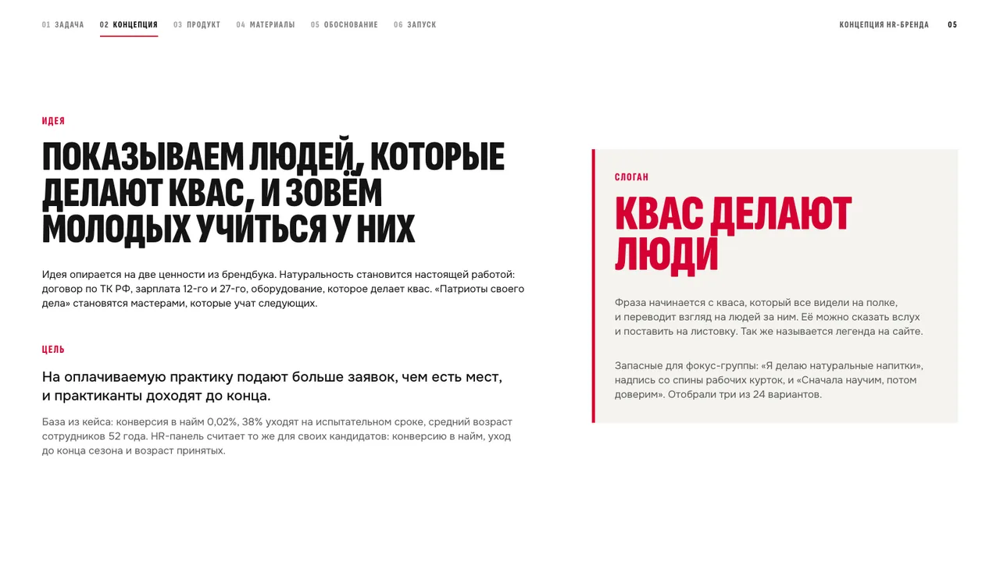

- **Идея.** Показываем людей, которые делают квас, и зовём молодых учиться у них. Она опирается на две ценности из брендбука: натуральность становится настоящей работой (договор по ТК РФ, зарплата 12-го и 27-го, оборудование, которое делает квас), а «патриоты своего дела» становятся мастерами, которые учат следующих.
- **Цель.** На оплачиваемую практику подают больше заявок, чем есть мест, и практиканты доходят до конца сезона.
- **Слоган «Квас делают люди».** Фраза начинается с кваса, который все видели на полке, и переводит взгляд на людей за ним. Её легко сказать вслух и поставить на листовку. Запасные варианты для фокус-группы: «Я делаю натуральные напитки» (надпись со спины рабочих курток) и «Сначала научим, потом доверим».

<a id="system"></a>
### Одна система вместо разовых ярмарок

Это основная проблема кейса. Экскурсии, музей, инженерные классы, вузы и ярмарки у «Очаково» уже есть, но никто не считает, какая точка приводит людей на смену. Мы связываем их в одну воронку:

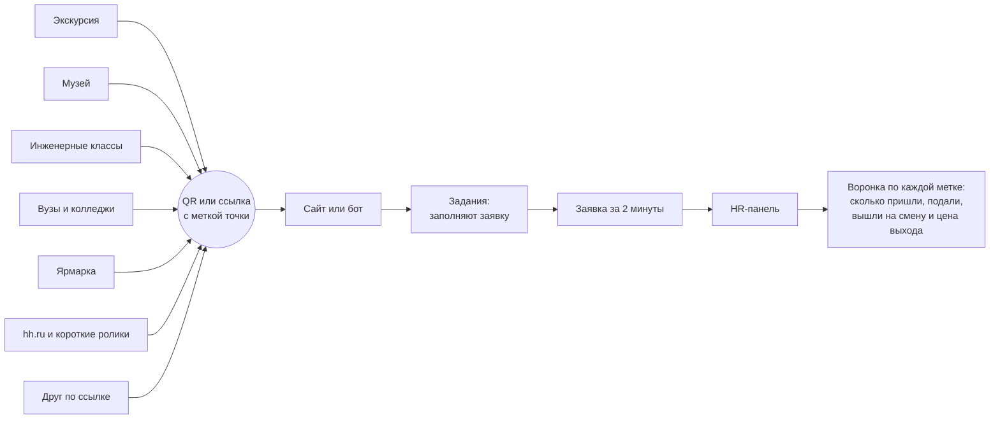

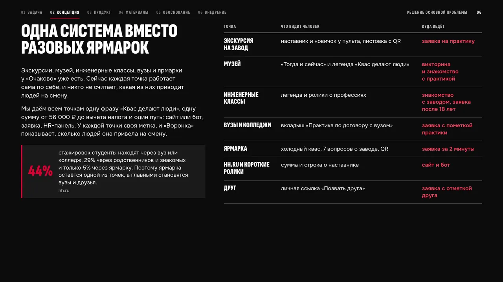

<a id="images"></a>
### Ключевые образы

Наставник и новичок у пульта, надпись «Я делаю натуральные напитки» на спине рабочей куртки, руки и оборудование, квас на свету, «тогда и сейчас» (комбинат к Олимпиаде-80 и тот же цех сегодня), пиктограммы из брендбука.

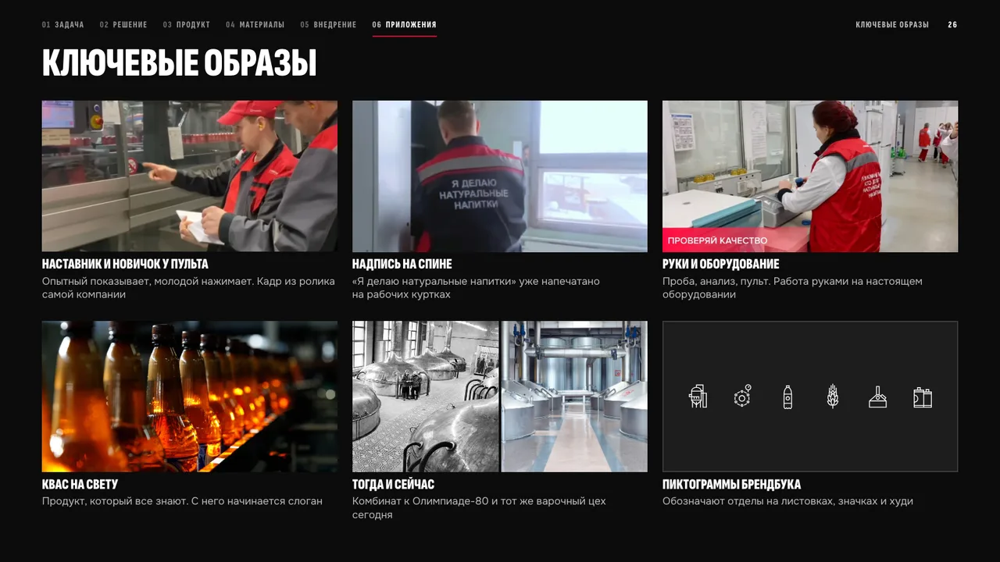

<a id="messages"></a>
### Что говорим каждой группе

Инженерам, лаборантам и технологам, студентам колледжей на линию и склад, 4-м курсам и выпускникам: у каждой группы свой страх и свой ответ с фактом из материалов компании.

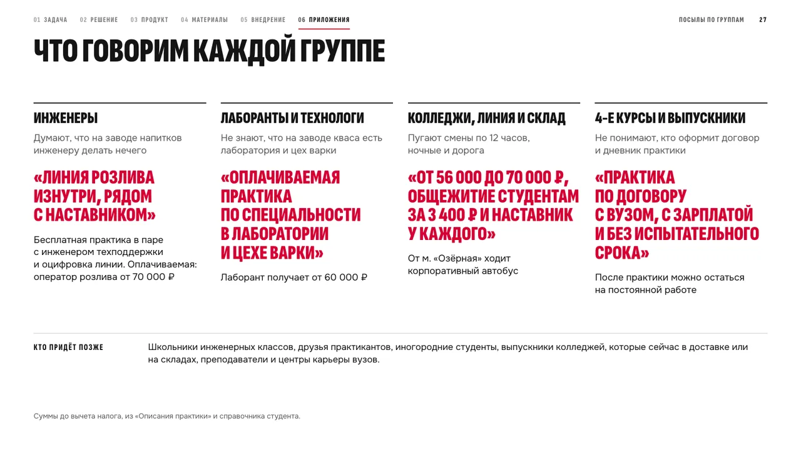

<a id="focus"></a>
### Фокус-группа

Три встречи по 75 минут, по 6–8 человек, у каждой своя группа. Пороги записаны до первой встречи: если слоган не пересказывают правильно двое из трёх, берём запасной. Кроме ответов считаем поведение: сканы QR с листовки, наклейки со стола и заявки по метке. Анкету можно пройти на сайте, HR видит ответы по группам. Протокол в [focus-group.md](docs/brand/focus-group.md).

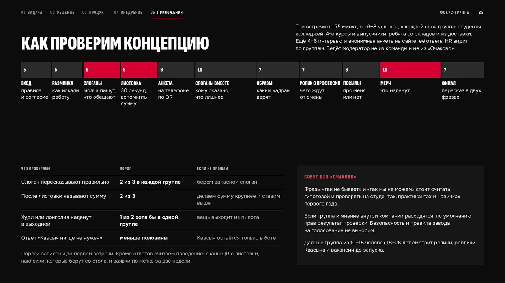

<br>

<a id="site"></a>
## Сайт для кандидата

Открывается по QR без установки. Тёмная основа, фирменный красный, крупный узкий шрифт, живые фото завода, логотип и пиктограммы из брендбука. Четыре задания «Смена N/4» прямо на странице: в шапке наполняются четыре бутылки.

<a id="site-start"></a>
### Первый экран и задания

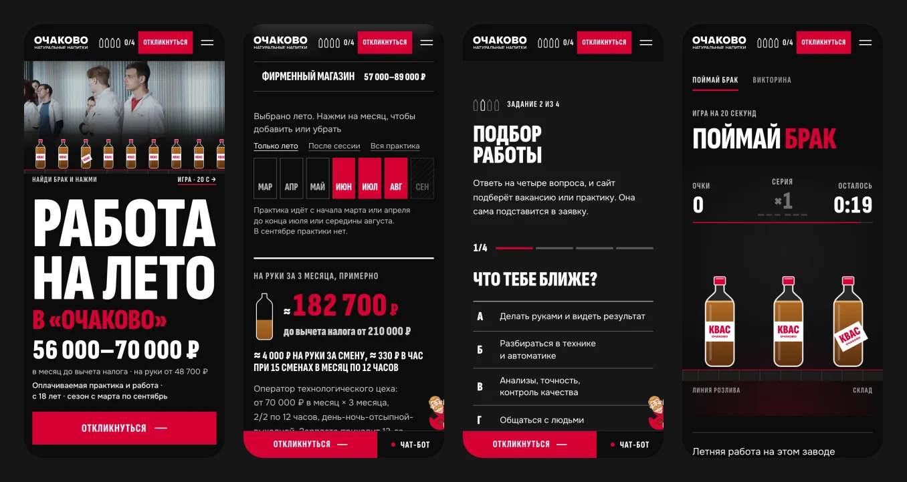

- **Первый экран.** Сразу видна сумма от 56 000 до 70 000 ₽ до вычета налога и сколько это на руки. По ленте едут бутылки кваса: на бракованную можно нажать и начать игру. 45% молодых до 24 лет не смотрят вакансии без суммы (SuperJob).
- **«Собери лето».** Кандидат выбирает должность и свободные месяцы и видит деньги за лето. Месяцы переходят в заявку.
- **«Подбор работы».** Четыре вопроса о том, что ближе, и сайт предлагает вакансию. Она сама встаёт в заявку.
- **«Поймай брак».** 20 секунд на линии розлива: найти бутылки без крышки, с недоливом или кривой этикеткой. Это часть работы оператора с зарплатой от 70 000 ₽.

<a id="site-company"></a>
### Знакомство с заводом

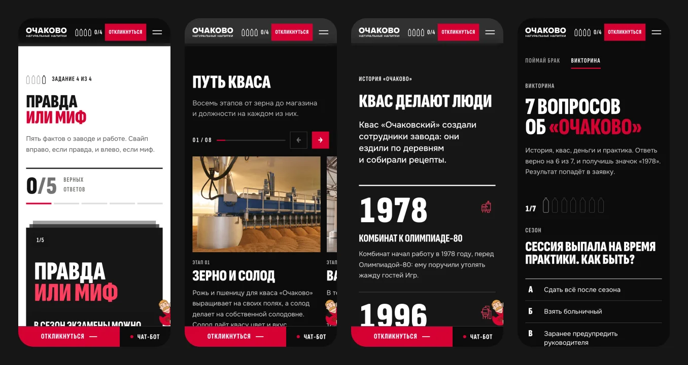

- **«Правда или миф».** Пять карточек вроде «без резюме не возьмут». Страхи разбираются до собеседования.
- **«Путь кваса».** Восемь этапов от зерна до полки и кто работает на каждом.
- **История и бренды.** Таймлайн 1978, 1996, 1998 и сегодня, «Очаково» в цифрах, квас «Очаковский», «Семейный секрет», «Очаковский лимонад», CoolCola. Только квас и безалкогольные напитки.
- **Викторина.** 7 вопросов о компании с объяснением после каждого ответа. За 6 верных значок «1978»: его забирают на стенде или экскурсии, а если заявка подана, HR видит результат и выдаёт значок в первый день.

<a id="site-apply"></a>
### Заявка и что с ней дальше

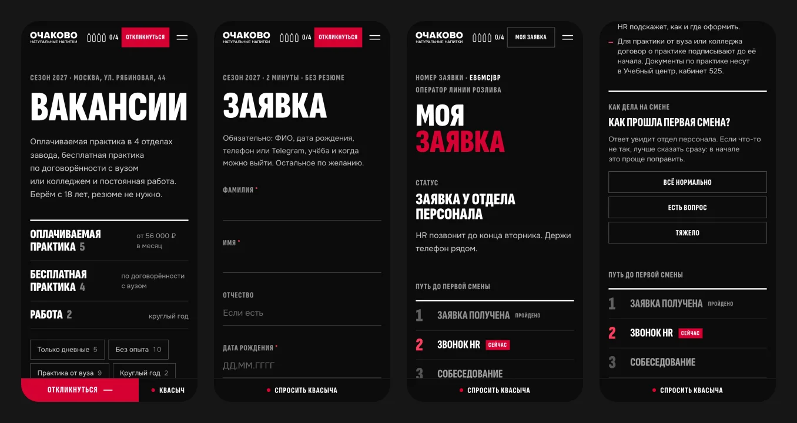

- **Заявка.** ФИО, телефон или Telegram, дата рождения, вакансия, когда можно выйти, вуз или колледж. Около двух минут, резюме не нужно. Моложе 18 лет заявку не примут сайт, бот и сервер.
- **«Моя заявка».** Номер, статус и когда позвонит HR. Можно самому выбрать час собеседования, позвать друга по личной ссылке и получать ответ HR в мессенджер.
- **«Как дела на смене».** После первой смены, через неделю и через месяц новичку приходит один вопрос. На ответ «тяжело» человек выбирает причину, видит, что можно сделать сразу, а у HR появляется задача перезвонить. 64% ушедших в первые полгода решили уйти в первый месяц (hh.ru и Dream Job).

<a id="site-more"></a>
### Что ещё есть на сайте

То, что не видно с первого взгляда. Из-за этого кандидат доходит до заявки, а HR знает, откуда он пришёл.

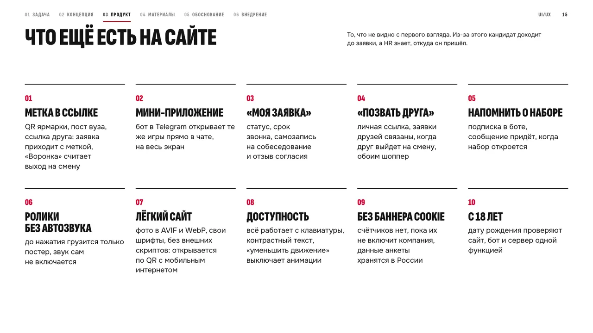

- **Метка в ссылке.** QR ярмарки, пост вуза, ссылка друга: заявка приходит с меткой, «Воронка» считает, сколько людей точка привела на смену.
- **Мини-приложение.** Бот в Telegram открывает те же игры прямо в чате, на весь экран. Это страница [/play](https://antihype.best/play).
- **«Позвать друга» и «Напомнить о наборе».** Личная ссылка связывает заявки друзей, подписка в боте пришлёт сообщение, когда набор откроется.
- **Ролики без автозвука.** До нажатия грузится только постер.
- **Лёгкий сайт.** Фото в AVIF и WebP, свои шрифты, без внешних скриптов и CDN: страница быстро открывается по QR на ярмарке с мобильным интернетом.
- **Доступность.** Всё работает с клавиатуры, текст контрастный, настройка «уменьшить движение» выключает анимации.
- **Без баннера cookie.** Счётчиков нет, пока их не включит компания. Данные анкеты хранятся в России.

<a id="path"></a>
### Путь кандидата

Красным отмечено, где кандидаты теряются, ниже то, что с этим делает продукт.

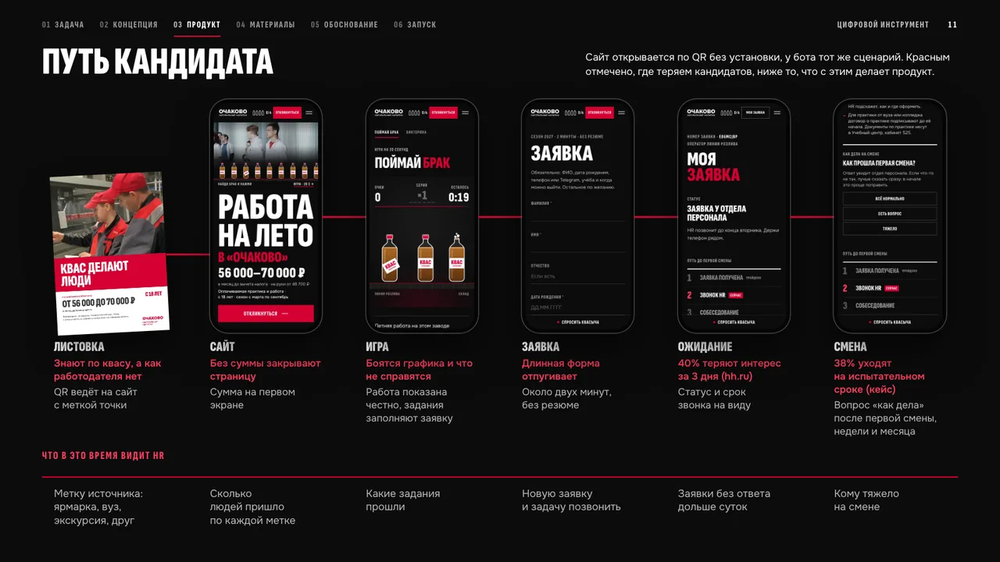

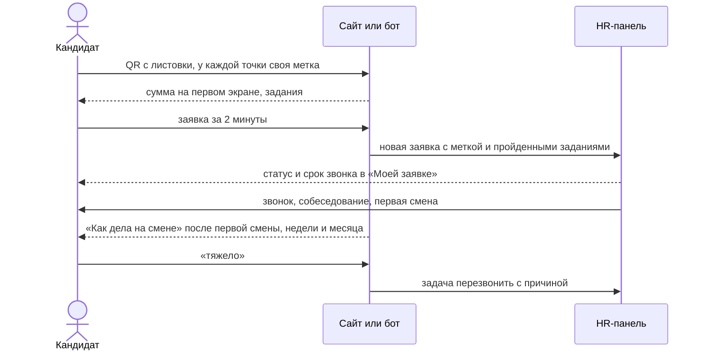

<br>

<a id="kvasych"></a>
## Квасыч: бот, помощник, маскот

<p>

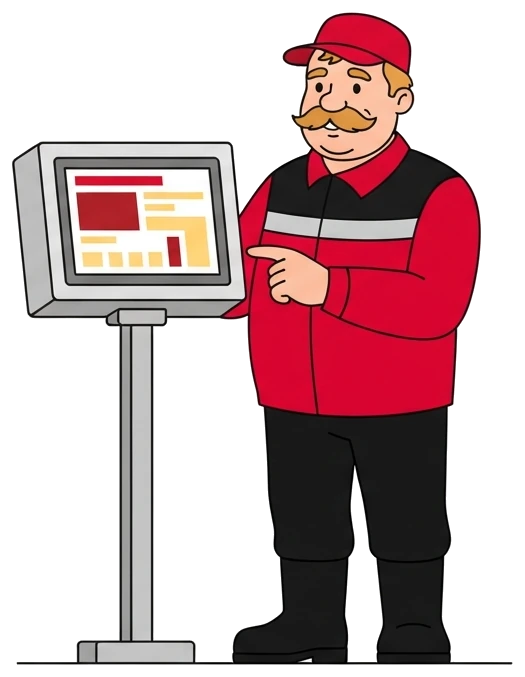
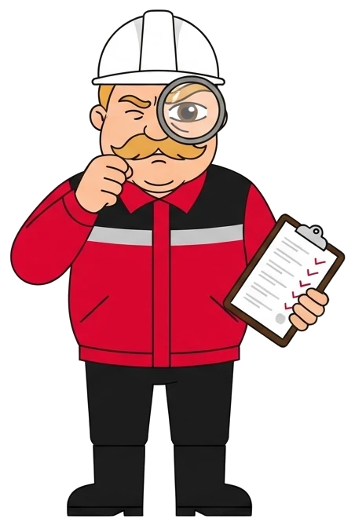
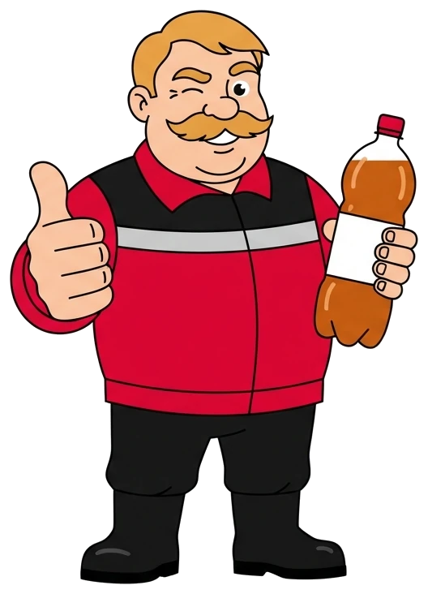
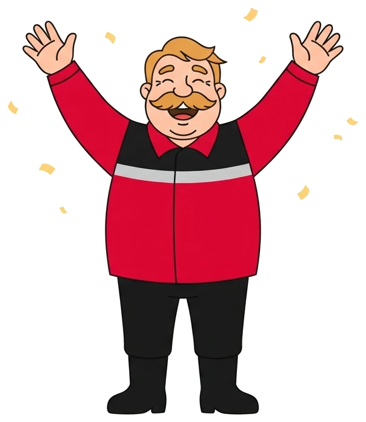
</p>

Квасыч, мастер-наставник с пышными усами в красной рабочей куртке, нарисован по образу наставников «Очаково». На сайте и в боте он подсказывает, а на заводе учит настоящий наставник.

- **Бот.** Те же разделы, что на сайте: вакансии, задания, викторина, заявка, «Моя заявка», напоминание о наборе. Один движок работает в чате на сайте, в Telegram и в MAX. Бот присылает приглашение на собеседование и напоминает о нём накануне.
- **Помощник на GigaChat.** Отвечает своими словами на вопросы вроде «сколько платят» или «где жить». Суммы и сроки берёт из вакансий, которые ведёт HR. Без ключа отвечает готовыми ответами из той же базы. Личные данные кандидата в модель не уходят.
- **Учится у HR.** Если точного ответа нет, Квасыч так и говорит и даёт телефон отдела подбора, а вопрос попадает в HR-панель. Ответ HR Квасыч дальше даёт всем.
- **Мини-приложение в Telegram.** Игры сайта открываются прямо в мессенджере: кнопка «Игры» у поля ввода, «Игры во весь экран» в меню и кнопки во вступлениях к «Поймай брак», «Собери лето» и викторине. Это страница [/play](https://antihype.best/play): игры по одной на экран, «Дальше» открывает следующее задание, результаты уходят в заявку так же, как на сайте.
- **Где бот сейчас.** Работает в чате на сайте. Тестовый бот в Telegram [@kvasantihypebot](https://t.me/kvasantihypebot) готов: профиль, меню и кнопка «Игры» ставятся сами при запуске. Сервер стенда стоит в России, где Telegram заблокирован, поэтому боту нужен прокси Bot API или второй сервер за рубежом, это описано в [deploy.md](docs/deploy.md). Для MAX код адаптера готов, живого бота нет: его может завести только компания.

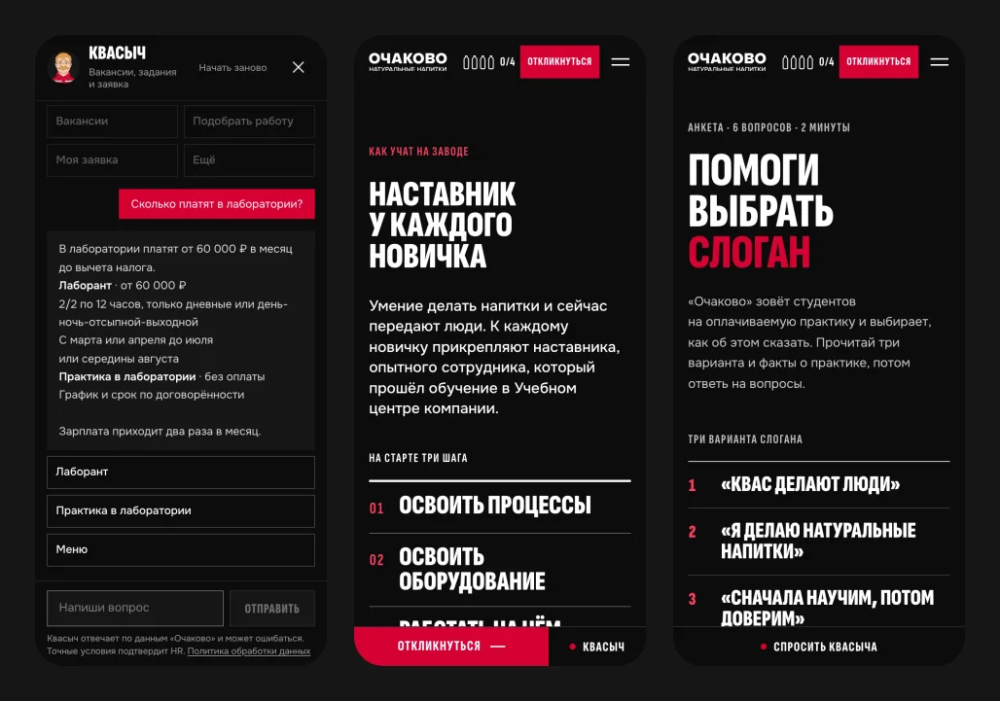

Позы, внешность и то, как он говорит, описаны в [kvasych.md](docs/kvasych.md), описания поз для генерации картинок в [kvasych-prompts.md](docs/kvasych-prompts.md).

<a id="bridge"></a>
### Мост в мессенджеры

Разделы, заявка, задания и Квасыч написаны один раз в общем движке диалогов. Канал только переводит сообщения и кнопки в свой формат. Новый мессенджер подключается своим переводчиком, сценарии не трогаем, так подключён MAX.

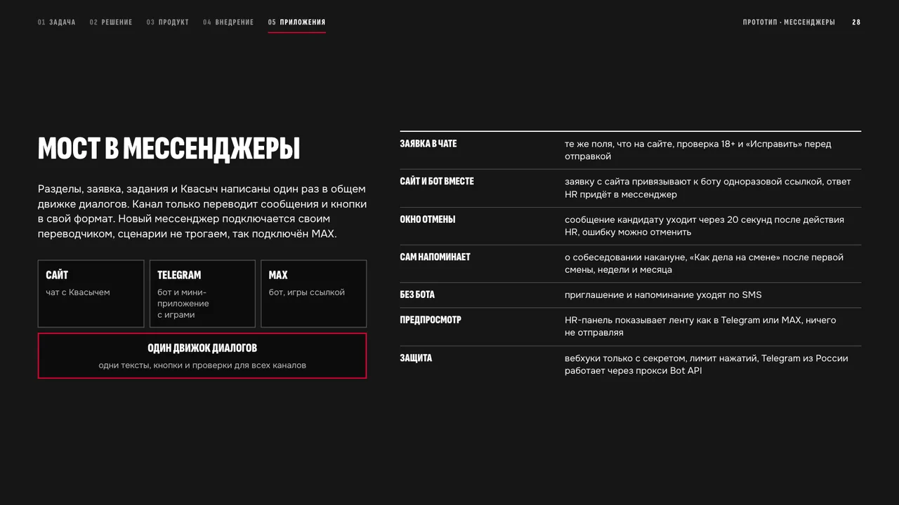

- **Заявка в чате:** те же поля, что на сайте, проверка 18+ и «Исправить» перед отправкой.
- **Сайт и бот вместе:** заявку с сайта привязывают к боту одноразовой ссылкой, ответ HR придёт в мессенджер.
- **Окно отмены:** сообщение кандидату уходит через 20 секунд после действия HR, ошибку можно отменить.
- **Сам напоминает:** о собеседовании накануне, «Как дела на смене» после первой смены, недели и месяца. Без бота приглашение и напоминание уходят по SMS.
- **Предпросмотр:** HR-панель показывает ленту как в Telegram или MAX, ничего не отправляя.
- **Защита:** вебхуки только с секретом, лимит нажатий. Telegram из России работает через прокси Bot API.

<br>

<a id="hr"></a>
## HR-панель

Панель ведёт сезон набора от первого отклика до итога и резерва на следующий год.

| | |
|:---:|:---:|
| 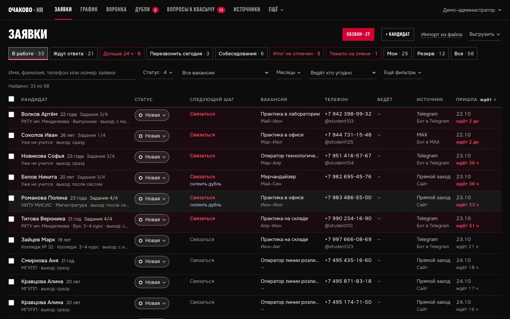<br>**Заявки.** С сайта, из бота, с hh.ru и добавленные вручную. Подборки: ждут ответа, дольше 24 часов, перезвонить сегодня, тяжело на смене | 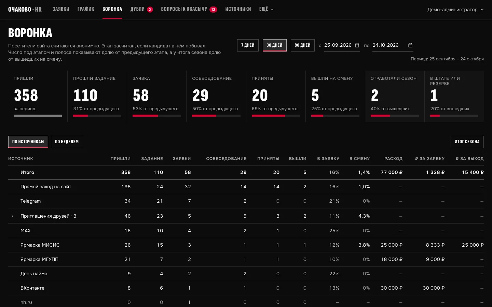<br>**Воронка.** По каждой метке: сколько пришли, подали заявку, вышли на смену и сколько стоил один выход |
| 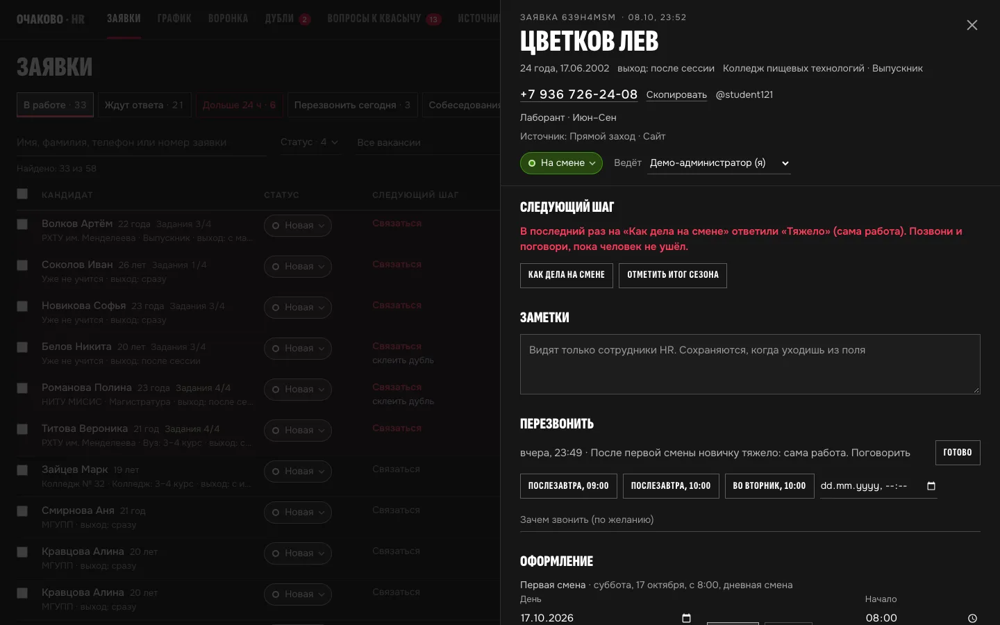<br>**Карточка.** История, следующий шаг, «перезвонить», оформление, наставник и документы по практике | 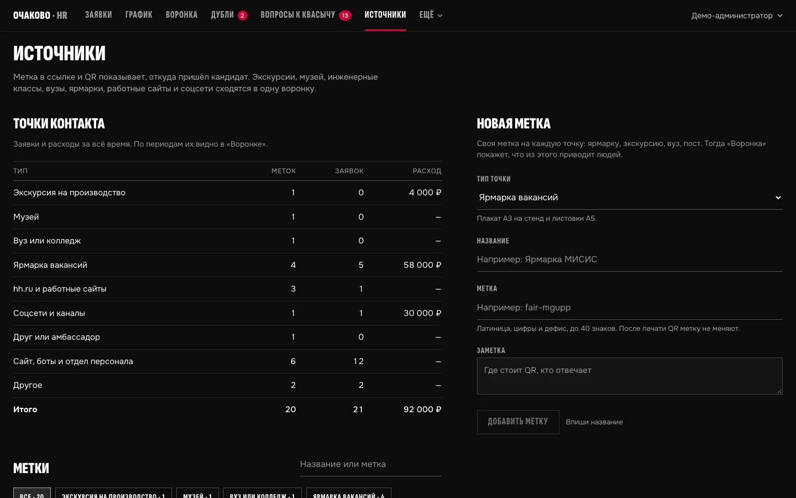<br>**Источники.** Метка, ссылка, QR, плакат A3 и листовка A5 на каждую точку контакта |
| 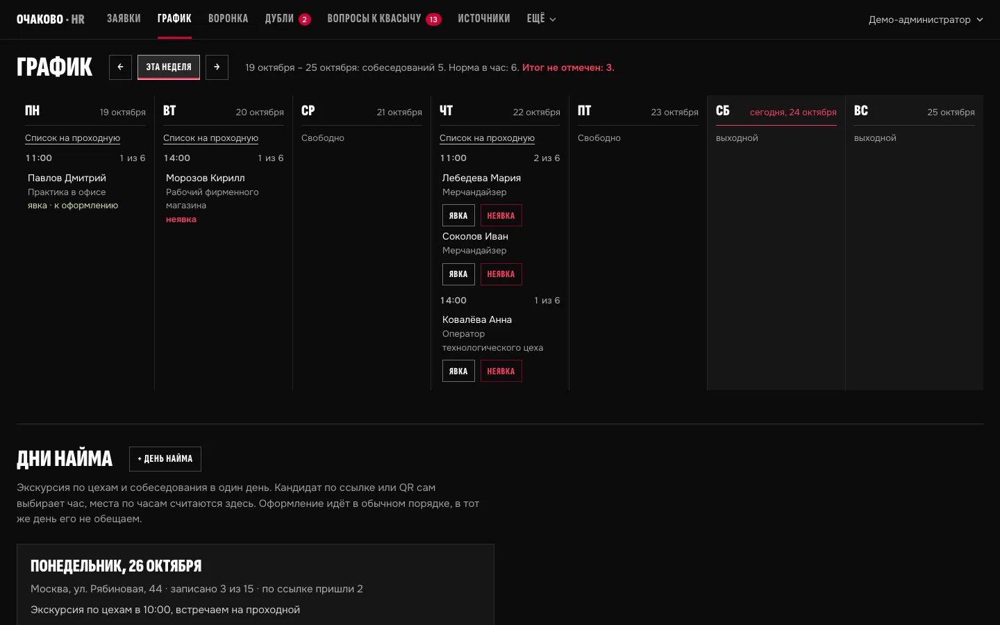<br>**Собеседования и день найма.** Экскурсия и собеседования в один день, кандидат сам выбирает час | 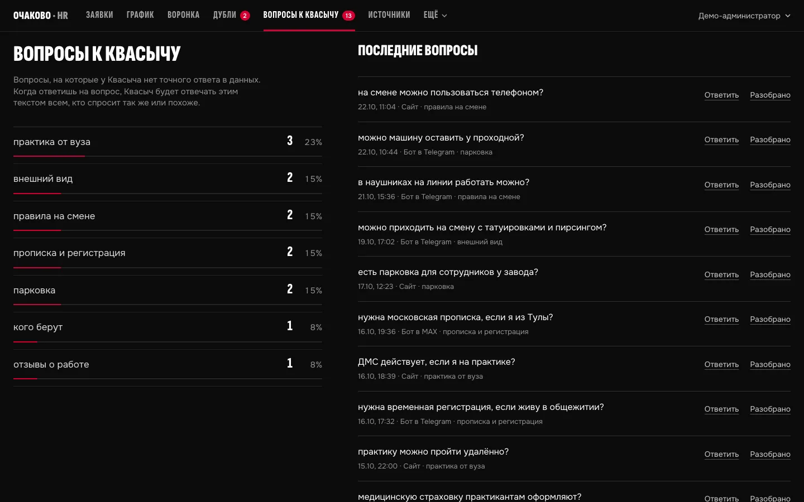<br>**Вопросы к Квасычу.** Вопрос без ответа уходит сюда, ответ HR Квасыч сразу даёт всем |
| 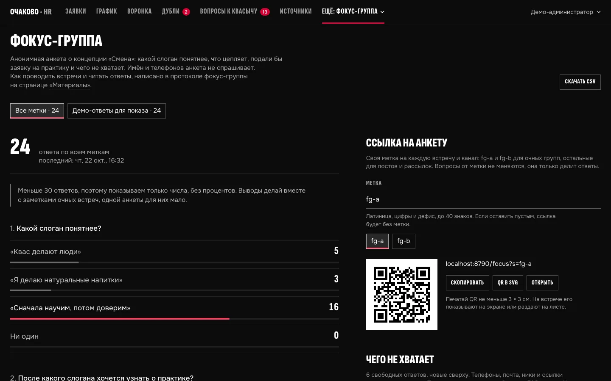<br>**Фокус-группа.** Ссылка и QR на анкету, ответы по группам, выгрузка CSV | 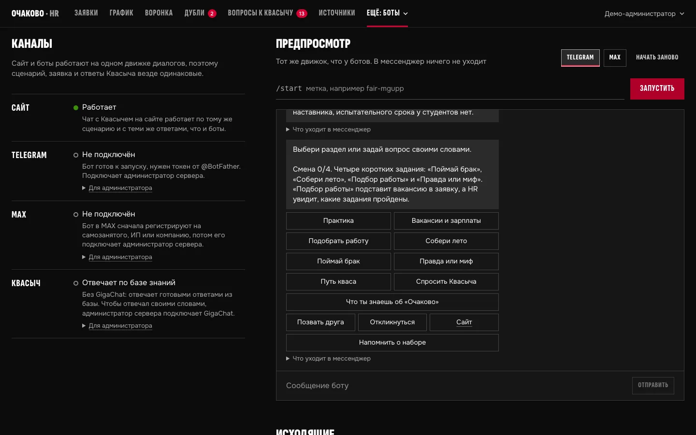<br>**Боты.** Состояние ботов и предпросмотр ленты в виде Telegram или MAX |

И ещё:

- **Выгрузки:** Excel, CSV, CSV для загрузки в 1С, копия на Яндекс Диск по расписанию.
- **Импорт** откликов hh.ru из файла.
- **Сообщения:**
  - шаблоны для бота и SMS;
  - рассылка «Открыт набор» тем, кто подписался.
- **Вакансии без программиста:** сумму и срок HR меняет сам, сайт и Квасыч сразу говорят новое.
- **План найма** по месяцам и список фамилий для охраны.
- **Роли и очередь:**
  - сотрудник HR и администратор;
  - новые заявки раздаются по кругу.
- **Итог сезона:** кто доработал, кто ушёл и почему, кого звать в штат.
- **Персональные данные:**
  - срок хранения;
  - удаление по запросу кандидата;
  - журнал выгрузок.

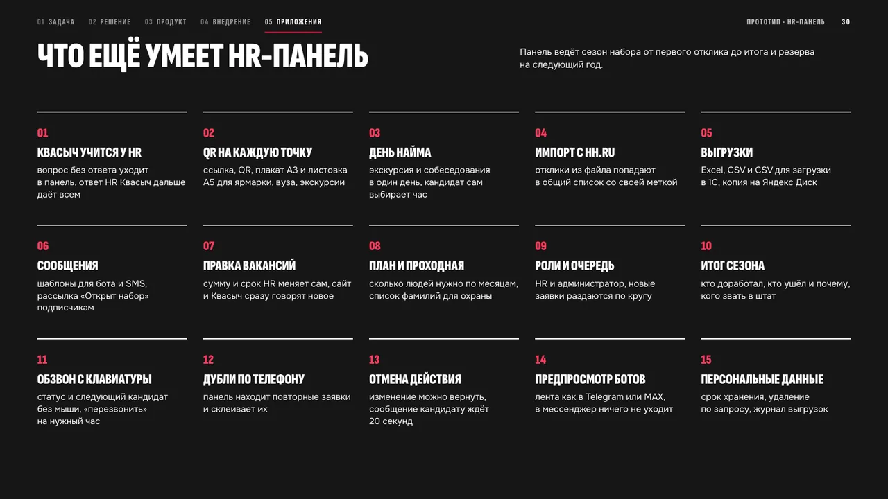

Подробно в [hr.md](docs/hr.md).

<br>

<a id="print"></a>
## Визуальные материалы: листовки и стенд

На лицевой стороне листовки слоган, сумма и QR с меткой точки, на обороте роли с суммами и три шага до собеседования. Ролл-ап видно издалека. Табличка на стол зовёт ответить на 7 вопросов о заводе, за ответы без ошибок дают носки.

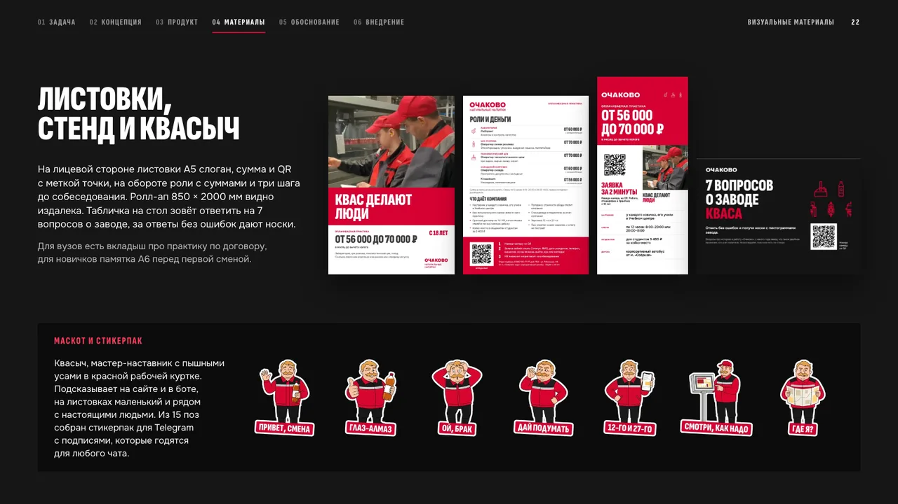

| Листовка A5 | Вкладыш для вузов | Памятка новичку A6 | Ролл-ап | Табличка на стол |
|:---:|:---:|:---:|:---:|:---:|
| 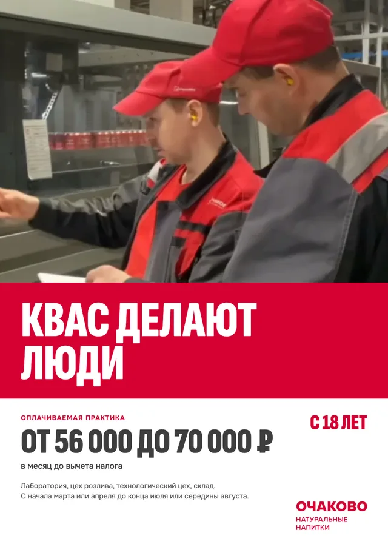 | 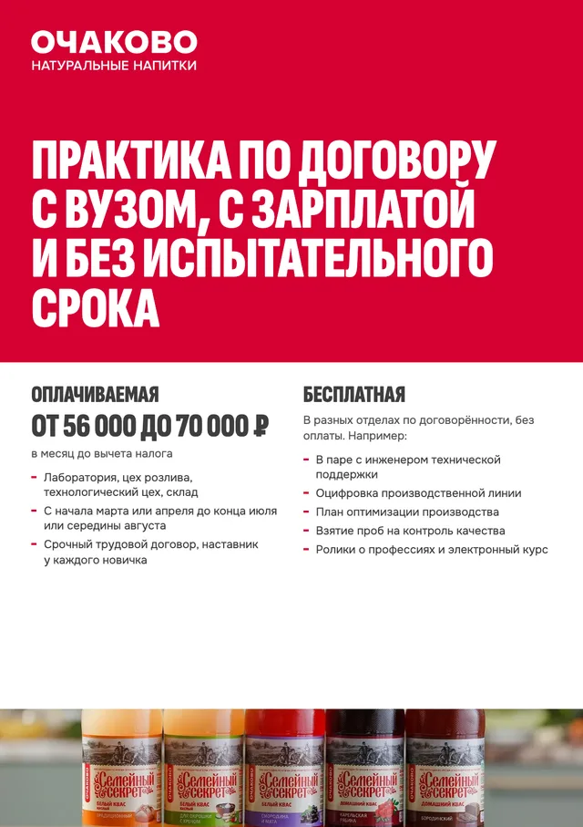 | 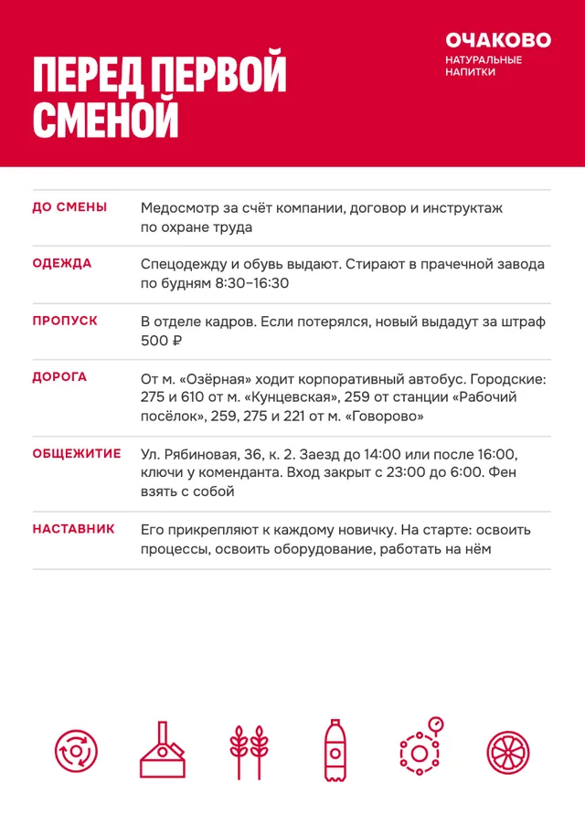 | 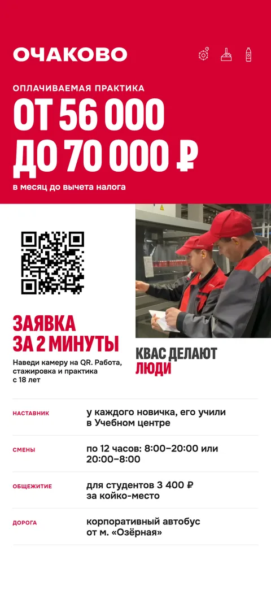 | 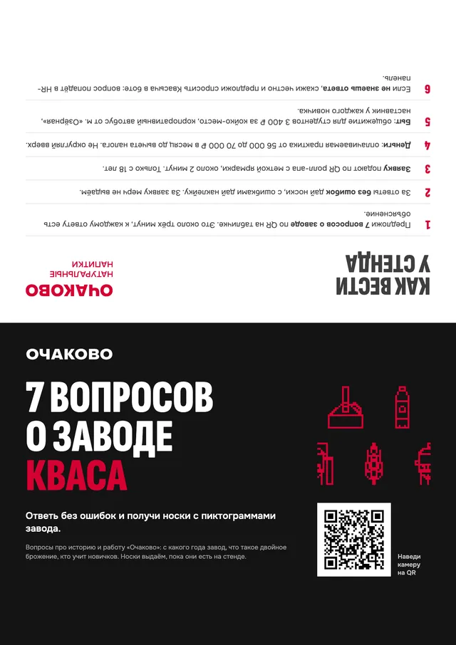 |
| [макет](https://antihype.best/materials/print/leaflet-a5.html) | [макет](https://antihype.best/materials/print/insert-vuz.html) | [макет](https://antihype.best/materials/print/first-shift-a6.html) | [макет](https://antihype.best/materials/stand/rollup.html) | [макет](https://antihype.best/materials/stand/table-tent.html) |

Описание образов, палитры и референсов в [visuals.md](docs/brand/visuals.md).

<br>

<a id="merch"></a>
## Мерч

Мерч нельзя купить, его выдают за шаги на заводе. Логотип маленький, а надписи понятны тем, кто работал на заводе.

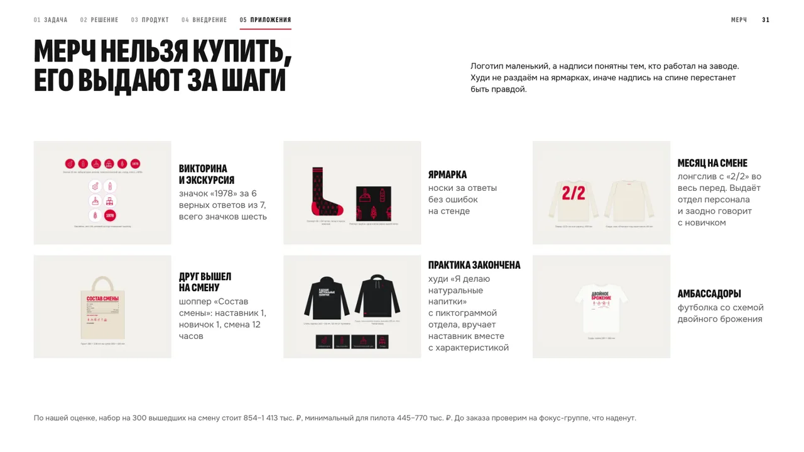

| Шаг | Вещь |
|---|---|
| Викторина и экскурсия | значок «1978» за 6 верных ответов из 7, всего значков шесть |
| Ярмарка | носки за ответы без ошибок на стенде |
| Месяц на смене | лонгслив с «2/2» во весь перед. Выдаёт отдел персонала и заодно говорит с новичком |
| Практика закончена | худи «Я делаю натуральные напитки» с пиктограммой отдела, вручает наставник вместе с характеристикой |
| Друг вышел на смену | шоппер «Состав смены»: наставник 1, новичок 1, смена 12 часов |
| Амбассадоры | футболка со схемой двойного брожения |

По нашей оценке, набор на 300 вышедших на смену стоит 854–1 413 тыс. ₽, минимальный для пилота 445–770 тыс. ₽. Технические рисунки с размерами в [макетах мерча](https://antihype.best/materials/merch/layouts.html), подробно в [merch.md](docs/brand/merch.md).

<br>

<a id="stickers"></a>
## Стикерпак для Telegram

15 стикеров из поз Квасыча с короткими подписями, которые годятся для любого чата. Рекламы в подписях нет: стикеры отправляют друзьям. В название набора ставим имя бота, поэтому каждый отправленный стикер напоминает о Квасыче.

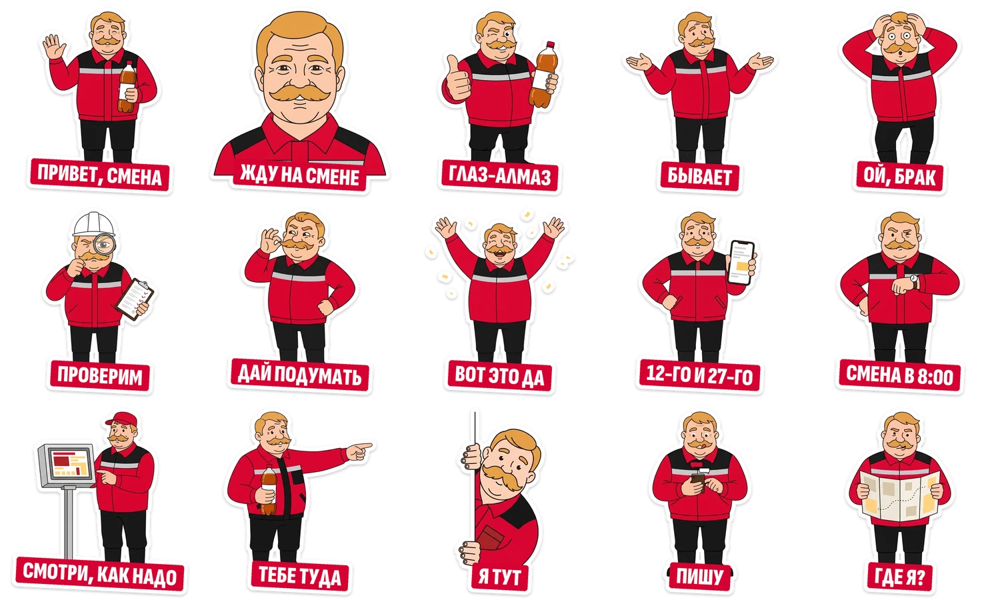

Файлы готовы для бота @Stickers: 512 × 512 px, PNG с прозрачным фоном. [Скачать набор](https://antihype.best/materials/stickers/kvasych-stickers.zip), файлы по одному в [docs/brand/stickers](docs/brand/stickers). Как опубликовать набор, написано в [kvasych.md](docs/kvasych.md#стикерпак).

<br>

<a id="legend"></a>
## Легенда «Квас делают люди»

Рецепт кваса «Очаковский» собирали сами сотрудники завода, они ездили по деревням. Сейчас умение передают наставники, обученные в Учебном центре. На сайте легенда стоит отдельным разделом с таймлайном, сразу за ним блок о наставниках. Ту же историю рассказывают Квасыч, викторина, экскурсия и музей. Полный текст в [concept.md](docs/brand/concept.md), раздел 7.

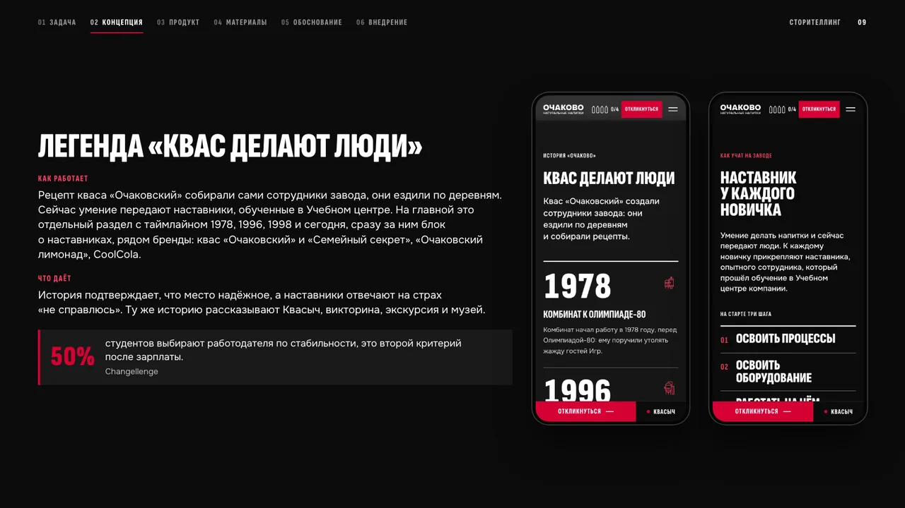

<br>

<a id="video"></a>
## Видеоролики о компании

Серия вертикальных роликов по 15–35 секунд вместо одного длинного. Каждый отвечает на один вопрос кандидата: сколько платят, что выдают в первый день, кто будет учить, что делать в сессию. Выпуск 12 «Квас делают люди» рассказывает о компании: настоящий наставник у пульта говорит новичку одну фразу и отходит на шаг.

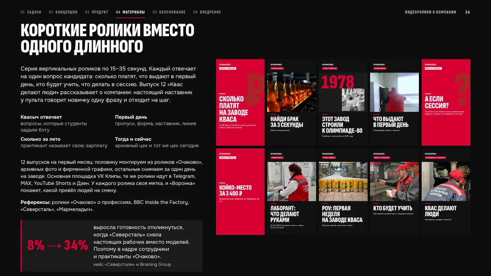

12 выпусков на первый месяц: половину монтируем из роликов «Очаково», архивных фото и фирменной графики, остальные снимаем за один день на заводе. Основная площадка VK Клипы, те же ролики идут в Telegram, MAX, YouTube Shorts и Дзен. Сценарии, съёмочный день и референсы в [clips.md](docs/brand/clips.md), [обложки](https://antihype.best/materials/clips/covers.html) в размере 1080 × 1920.

<br>

<a id="rationale"></a>
## Обоснование: исследования и правила завода

### Что мы заметили

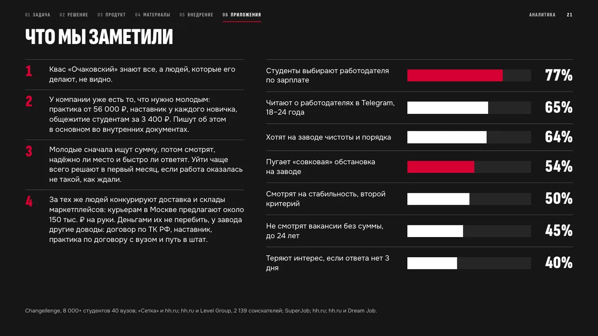

| Цифра | Что значит | Источник |
|---|---|---|
| 77% | студентов выбирают работодателя по зарплате | Changellenge, 8 000+ студентов 40 вузов |
| 65% | людей 18–24 лет читают о работодателях в Telegram | «Сетка» и hh.ru |
| 45% | молодых до 24 лет не смотрят вакансии без суммы | SuperJob |
| 40% | соискателей теряют интерес, если ответа нет 3 дня | hh.ru |
| 56% | ушедших в первые полгода говорят, что работа не совпала с описанием | hh.ru и Dream Job |
| 44% | стажировок студенты находят через вуз или колледж, 29% через знакомых, 5% через ярмарку | hh.ru |
| 8% → 34% | выросла готовность откликнуться, когда «Северсталь» сняла настоящих рабочих вместо моделей | кейс «Северстали» и Braining Group |
| +71% | заявок получила британская армия, назвав молодых «снежинками», а поступивших стало меньше. Поэтому меряем выход на смену, а не клики | Marketing Week |

### Молодые работают не хуже

Метаанализ по 20 тысячам работников показал, что поколения относятся к работе почти одинаково, а разницу объясняют возраст и стаж. Первую работу часто меняют в любом поколении: американские бумеры в 18–24 года сменили 5,6 места работы. Ненадёжные люди есть в любом поколении, по году рождения их не вычислить.

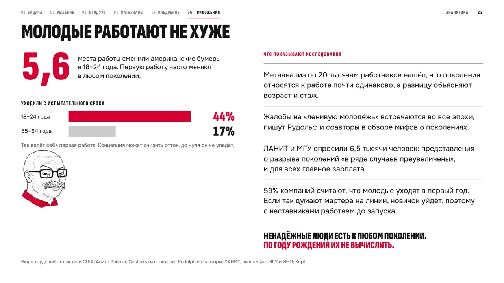

### Правила завода не меняются

Новичку объясняем, зачем каждое правило и кого оно защищает: форма, время, своё дело у линии, «вы» к наставнику, экзамен заранее. Смысл работы передаёт живой человек рядом, поэтому о нём говорит наставник.

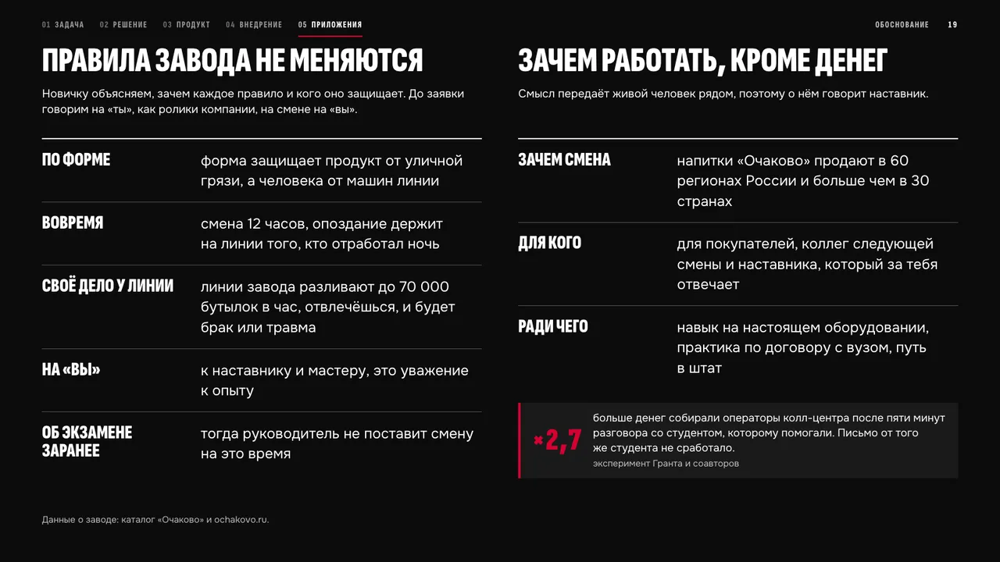

Подробно: [rationale.md](docs/brand/rationale.md), [position.md](docs/brand/position.md), [analytics.md](docs/analytics.md).

<br>

<a id="analogs"></a>
## Аналоги и что придумали сами

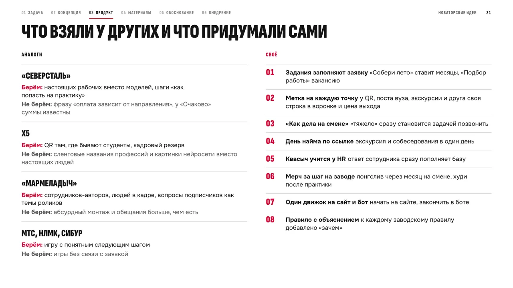

Своё:
1. Задания заполняют заявку.
2. Метка на каждую точку контакта с ценой выхода на смену.
3. «Как дела на смене» с задачей перезвонить.
4. День найма по ссылке.
5. Квасыч учится у HR.
6. Мерч за шаг на заводе.
7. Один движок на сайт и бот.
8. Правило с объяснением.

<br>

<a id="secondary"></a>
## Второстепенные проблемы

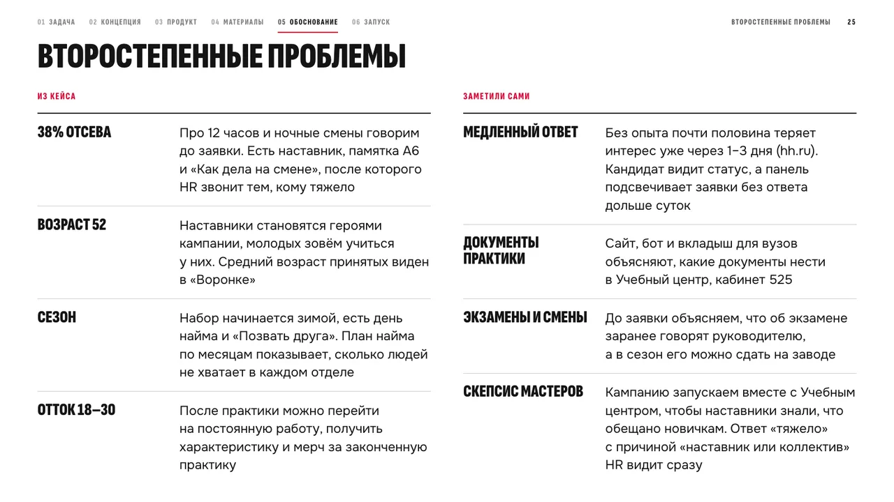

| Проблема | Что делаем |
|---|---|
| 38% отсева на испытательном сроке | про 12 часов и ночные смены говорим до заявки; наставник, памятка A6 и «Как дела на смене» |
| Средний возраст 52 года | наставники становятся героями кампании, молодых зовём учиться у них |
| Сезонный рост штата | набор начинается зимой, день найма, «Позвать друга», план найма по месяцам |
| Отток 18–30 лет | переход на постоянную работу после практики, характеристика, мерч за законченную практику |
| Медленный ответ HR (заметили сами) | статус на виду у кандидата, панель подсвечивает заявки без ответа дольше суток |
| Документы практики (заметили сами) | сайт, бот и вкладыш для вузов объясняют, что нести в Учебный центр |
| Экзамены и смены (заметили сами) | об экзамене заранее говорят руководителю, в сезон его можно сдать на заводе |
| Скепсис мастеров к молодым (заметили сами) | кампанию запускаем с Учебным центром, чтобы наставники знали, что обещано новичкам |

<br>

<a id="build"></a>
## Разработка и внедрение

<a id="arch"></a>
### Как устроено и почему так

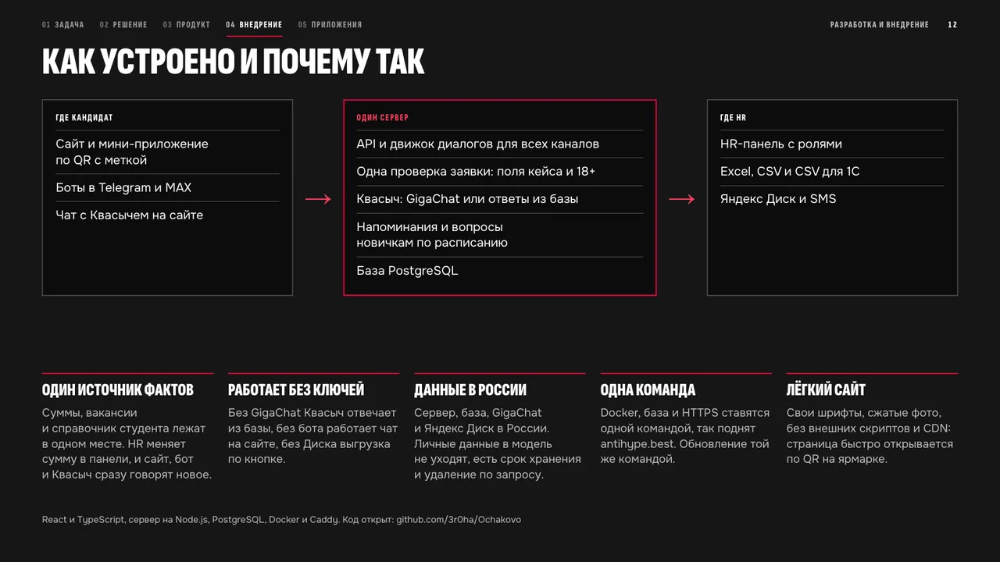

| Решение | Почему так |
|---|---|
| Один источник фактов | Суммы, вакансии и справочник студента лежат в одном месте. HR меняет сумму в панели, и сайт, бот и Квасыч сразу говорят новое. |
| Работает без ключей | Без GigaChat Квасыч отвечает из базы, без бота работает чат на сайте, без Диска выгрузка по кнопке. Ключи компании включают остальное. |
| Данные в России | Сервер, база, GigaChat и Яндекс Диск в России. Личные данные кандидата в модель не уходят, есть срок хранения и удаление по запросу. |
| Одна команда | Docker, база и HTTPS ставятся одной командой, так поднят antihype.best. Обновление той же командой. |
| Лёгкий сайт | Свои шрифты, сжатые фото, без внешних скриптов и CDN: страница быстро открывается по QR на ярмарке. |

Стек: React и TypeScript, сервер на Node.js, PostgreSQL, Docker и Caddy. Подробно в [tech.md](docs/tech.md) и [deploy.md](docs/deploy.md).

<a id="launch"></a>
### Сколько стоит и что нужно от компании

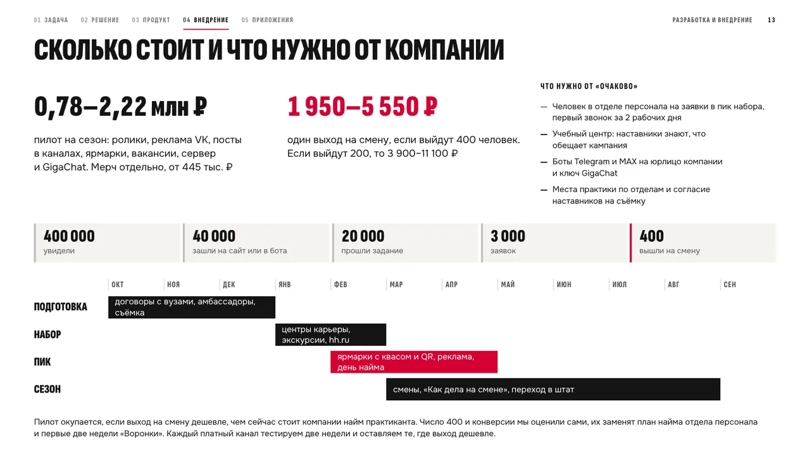

- **Пилот на сезон: 0,78–2,22 млн ₽.** Ролики, реклама VK, посты в каналах, ярмарки, вакансии, сервер и GigaChat. Мерч отдельно, от 445 тыс. ₽.
- **Один выход на смену: 1 950–5 550 ₽**, если выйдут 400 человек. Если выйдут 200, то 3 900–11 100 ₽.
- Суммы оценочные, число 400 и конверсии мы оценили сами. Их заменят план найма отдела персонала и первые две недели «Воронки». Каждый платный канал тестируем две недели и оставляем те, где выход дешевле.

Календарь сезона:

| Когда | Этап | Что делаем |
|---|---|---|
| октябрь–декабрь | Подготовка | договоры с вузами, амбассадоры, съёмка роликов |
| январь–февраль | Набор | центры карьеры, экскурсии, hh.ru |
| февраль–апрель | **Пик** | ярмарки с квасом и QR, реклама, день найма |
| март–сентябрь | Сезон | смены, «Как дела на смене», переход в штат |

Что нужно от «Очаково»:
- человек в отделе персонала на заявки в пик набора и первый звонок за 2 рабочих дня;
- Учебный центр, чтобы наставники знали, что обещает кампания;
- боты Telegram и MAX на юрлицо компании и ключ GigaChat;
- места практики по отделам и согласие наставников на съёмку.

Маркетинговая и PR-стратегия со сметой в [strategy.md](docs/strategy.md).

<br>

<a id="scale"></a>
## Масштабируемость решения

Следующий сезон дешевле первого: разработка уже сделана, остаются сервер, GigaChat и реклама.

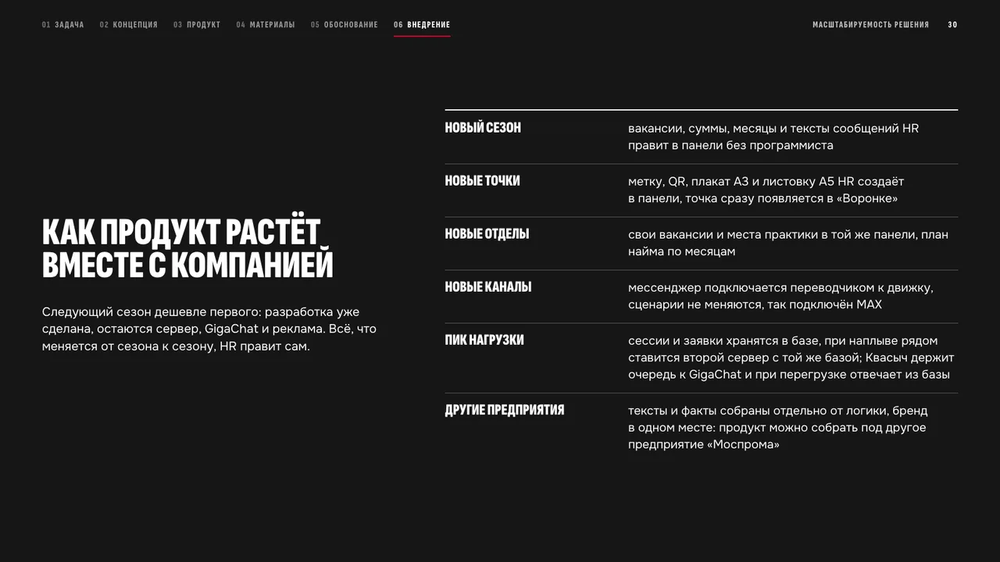

- **Новый сезон:** вакансии, суммы, месяцы и тексты сообщений HR правит в панели без программиста.
- **Новые точки контакта:** метку, QR, плакат A3 и листовку A5 HR создаёт в панели, точка сразу появляется в «Воронке».
- **Новые отделы:** свои вакансии и места практики в той же панели, план найма по месяцам.
- **Новые каналы:** мессенджер подключается переводчиком к движку диалогов, сценарии не меняются.
- **Пик нагрузки:** сессии и заявки хранятся в базе, при наплыве рядом ставится второй сервер с той же базой. Квасыч держит очередь к GigaChat и при перегрузке отвечает из базы.
- **Другие предприятия:** тексты и факты собраны отдельно от логики, бренд в одном месте, продукт можно собрать под другое предприятие «Моспрома».

<br>

<a id="criteria"></a>
## Критерии оценки: где ответ

Названия совпадают с обязательными слайдами для технологических и управленческих кейсов. В шапке каждого слайда презентации написано, к какому критерию он относится. Слайды 1–15 рассказывают решение, с 16-го идут приложения: исследования, обоснования и подробности.

| Критерий | Ответ | Где проверить |
|---|---|---|
| Прототип | сайт, мини-приложение, HR-панель и бот в чате сайта работают на antihype.best; бот для Telegram и MAX на том же движке включается токеном | [сайт](https://antihype.best), [игры](https://antihype.best/play), [HR-панель](https://antihype.best/hr); презентация, слайды 5, 8, 10, 29 и 30 |
| Решение и решение основной проблемы | одна система вместо разовых ярмарок: общая фраза и сумма, метка у каждой точки контакта, воронка до выхода на смену | [одна система](#system); HR-панель, «Источники» и «Воронка»; презентация, слайды 3, 4 и 10 |
| Разработка и внедрение | как устроено и почему, развёртывание одной командой, смета, календарь, что нужно от компании | [разработка и внедрение](#build); презентация, слайды 12 и 13 |
| Эффект и затраты | по нашей оценке пилот 0,78–2,22 млн ₽, один выход на смену 1 950–5 550 ₽ | [смета](#launch); презентация, слайд 13 |
| Новаторские идеи | задания заполняют заявку, «Как дела на смене», метка у каждой точки, Квасыч учится у HR, мерч за шаги | [аналоги и своё](#analogs); презентация, слайды 9, 22 и 31 |
| UI/UX | сумма на первом экране, игра на 20 секунд, заявка за 2 минуты, статус и срок звонка, доступность | сайт на телефоне; презентация, слайды 6, 7, 27 и 28 |
| Масштабируемость решения | новый сезон, отделы, точки и каналы без новой разработки | [масштабируемость](#scale); презентация, слайд 14 |
| Второстепенные проблемы | 38% отсева, возраст 52 года, сезонный рост штата, отток 18–30 лет и то, что заметили мы | [второстепенные проблемы](#secondary); презентация, слайд 21 |
| Аналитика | что важно молодым, конкуренты за тех же людей, путь кандидата, аналоги, исследования поколений | [обоснование](#rationale); презентация, слайды 5, 18, 19, 22 и 24 |

<br>

<a id="requirements"></a>
## Требования кейса: где в продукте

| Требование | Где | Как проверить |
|---|---|---|
| Анкета: ФИО, контакты, дата рождения, вакансия, готовность выйти, вуз или колледж | форма [/apply](https://antihype.best/apply) и заявка в боте; сайт, бот и сервер проверяют её одной функцией | отправить анкету без даты рождения: у поля появится «Укажи дату рождения» |
| Только с 18 лет | сайт, бот, сервер и база не примут заявку моложе 18 | ввести дату рождения моложе 18 лет: сайт ответит «Берём с 18 лет» |
| Лёгкая игровая форма | четыре задания на главной: «Собери лето», «Подбор работы», «Поймай брак», «Правда или миф»; игра отдельно на [/game](https://antihype.best/game) | пройти задание, и счётчик «Смена N/4» в шапке вырастет |
| Контрольные вопросы на знание компании | [викторина](https://antihype.best/game?t=quiz): 7 случайных из 12 вопросов, у каждого источник | после ответа сразу видно объяснение, за 6 верных значок «1978» |
| История, направления, карьерные возможности, бренды | главная: таймлайн, «Очаково» в цифрах, бренды, «Путь кваса»; [вакансии](https://antihype.best/vacancies): роли практики в четырёх отделах | на главной найти таймлайн и квас «Очаковский» |
| Связь с аудиторией | бот Telegram и MAX на одном движке, чат на сайте, «Моя заявка» с выбором времени собеседования, сообщения HR в бот, SMS для тех, у кого нет бота, «Напомнить о наборе» | HR-панель, вкладка «Боты»: предпросмотр ленты |
| Концепция HR-бренда в презентации | [презентация](https://antihype.best/materials/deck/index.html), [PDF](docs/brand/deck/ochakovo-smena.pdf), [concept.md](docs/brand/concept.md) | [концепция](#concept) |
| Визуальные материалы | листовки, вкладыш, памятка, ролл-ап, табличка, маскот, стикеры | [материалы](#print), [стикеры](#stickers) |
| Мерч | коллекция «Смена» и макеты с размерами | [мерч](#merch) |
| Сторителлинг | легенда «Квас делают люди» на сайте, в боте, в викторине и на экскурсии | [легенда](#legend) |
| Видеоролик о компании | серия коротких роликов: 12 сценариев, обложки; ролики компании о профессиях на сайте в «Смене изнутри» | [ролики](#video) |
| Обоснование и аналитика | исследования с источниками у каждой цифры | [обоснование](#rationale) |
| Проверка концепции через фокус-группу | анкета на сайте, результаты по группам в HR-панели, протокол | [фокус-группа](#focus) |
| Рост потока кандидатов, единая система | метка на каждую точку контакта, QR и печать на метку, воронка до выхода на смену | [одна система](#system) |
| Головной офис, ул. Рябиновая, 44 | адрес, корпоративный автобус от м. «Озёрная», телефоны отдела подбора и Учебного центра | спросить Квасыча «как добраться» |

<br>

<a id="keys"></a>
## Что работает без ключей и что нужно для запуска

Живых ключей у команды нет. Каждая интеграция проверена на имитации внешнего сервиса и включается настройкой на сервере.

| Что | Без ключа | Что нужно от «Очаково» |
|---|---|---|
| Помощник Квасыч на GigaChat | отвечает готовыми ответами из той же базы | ключ GigaChat API на юрлицо |
| Бот в Telegram | работает в чате на сайте | бот на аккаунт компании |
| Бот в MAX | код готов, живого бота нет | регистрация бота на юрлицо |
| Яндекс Диск | выгрузка «Заявки.xlsx» по кнопке | корпоративный Диск Яндекс 360 |
| SMS | панель показывает «Позвони кандидату» и готовый текст | договор с SMS.ru или SMSC.ru |
| hh.ru | предпросмотр вакансии и импорт откликов из файла | доступ работодателя |
| Яндекс Метрика и пиксель VK | счётчиков нет | ID счётчиков, скрипты грузятся только после согласия в плашке cookie |

<br>

<a id="agree"></a>
## Что согласовать с «Очаково»

- Срок ответа HR: на сайте и в боте обещан первый звонок за 2 рабочих дня.
- Кто перезванивает новичку после ответа «тяжело»: отдел персонала или Учебный центр.
- ДМС: в материалах компании его нет, поэтому мы его не обещаем.
- Политика обработки персональных данных и текст согласия.
- Места оплачиваемой практики по отделам и начало сезона, март или апрель.
- Корпоративный автобус от м. «Озёрная»: расписание.
- Общежитие: сколько мест на сезон и как бронировать.
- Настоящие наставники на сайте и в роликах, только с их письменного согласия.
- Логотип, фото с ochakovo.ru и ролики о профессиях: согласие на публикацию.
- Шрифт Proxima Nova из брендбука платный: на сайте пока свои шрифты.

<br>

<a id="next"></a>
## Что дальше

- Живые ключи и аккаунты компании: GigaChat, боты в Telegram и MAX, Яндекс Диск, hh.ru, SMS.
- Фокус-группа со студентами и выпускниками по плану выше.
- Карточки настоящих наставников на главной и в боте.
- Съёмочный день и первые 12 роликов.
- Листовки, стенд и мерч в производство после согласования.
- Пилот: две недели кампании, пересчёт целей по «Воронке» и перенос бюджета туда, где выход на смену дешевле.
- Публикация стикерпака от аккаунта компании.
- Загрузка кандидатов в 1С:ЗУП через интегратора компании по шаблону «CSV для 1С».

<br>

<a id="docs"></a>
## Все документы

| Документ | О чём |
|---|---|
| [case.md](docs/case.md) | кейс и официальные факты компании |
| [brand/README.md](docs/brand/README.md) | все материалы по бренду одним списком |
| [brand/concept.md](docs/brand/concept.md) | концепция HR-бренда: идея, цель, слоган, образы, тон, легенда, посылы |
| [brand/position.md](docs/brand/position.md) | с кем говорим, почему так, на какие данные опираемся |
| [brand/rationale.md](docs/brand/rationale.md) | обоснование концепции |
| [brand/focus-group.md](docs/brand/focus-group.md) | протокол фокус-группы |
| [brand/visuals.md](docs/brand/visuals.md) | листовки, маскот, образы, референсы |
| [brand/merch.md](docs/brand/merch.md) | коллекция мерча, за что выдают, сколько стоит |
| [brand/clips.md](docs/brand/clips.md) | короткие ролики: сценарии, съёмочный день, правила |
| [analytics.md](docs/analytics.md) | аудитория, проблемы опыта кандидата, аналоги |
| [strategy.md](docs/strategy.md) | маркетинговая и PR-стратегия, метрики, смета пилота |
| [kvasych.md](docs/kvasych.md) | маскот: роль, позы, как говорит, стикерпак |
| [kvasych-prompts.md](docs/kvasych-prompts.md) | описания поз Квасыча для генерации картинок |
| [hr.md](docs/hr.md) | HR-панель: заявки, собеседования, выгрузки, хранение данных |
| [llm.md](docs/llm.md) | помощник Квасыч на GigaChat |
| [roadmap.md](docs/roadmap.md) | что сделано и что дальше |
| [speech.md](docs/speech.md) | текст выступления по демо на 5 минут: что на экране и что говорить |
| [demo.md](docs/demo.md) | подготовка к показу: вкладки, вопросы жюри, запасной план |
| [quality-brief.md](docs/quality-brief.md) | правила текстов |
| [tech.md](docs/tech.md) | техническое описание: запуск, база, API, боты, защита |
| [deploy.md](docs/deploy.md) | развёртывание и эксплуатация |

<br>

<a id="dev"></a>
## Для разработчиков

Один процесс Node обслуживает сайт, HR-панель и ботов. Сайт на React, сервер на Hono, данные в PostgreSQL. Сценарии бота не знают про мессенджеры: движок возвращает сообщения в общем формате, а адаптеры Telegram и MAX только доставляют их.

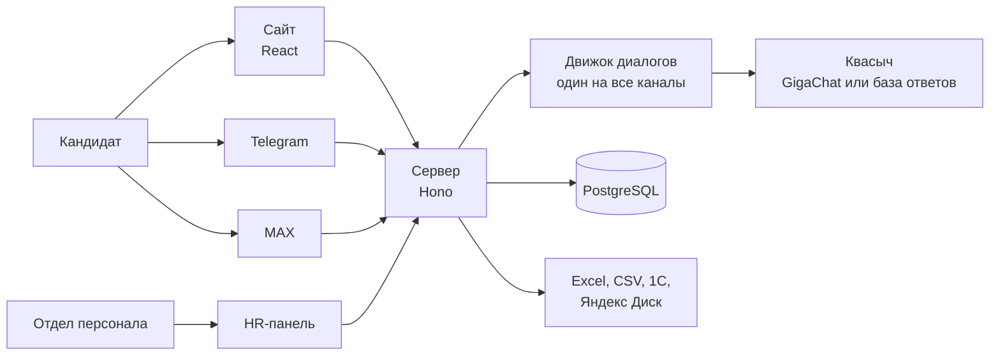

Запустить у себя (нужны Node.js 24, pnpm и PostgreSQL 16):

```bash
pnpm install
cp .env.example .env        # DATABASE_URL: адрес базы
createdb ochakovo
pnpm dev:all                # сайт http://localhost:5180, API http://localhost:8787
```

В Docker одним образом:

```bash
cp .env.example .env        # POSTGRES_PASSWORD, HR_ADMIN_EMAIL, HR_ADMIN_PASSWORD, SITE_URL
docker compose --profile local-db up -d --build
```

Бот в терминале: `pnpm bot:sim`. Проверка типов: `pnpm typecheck`. Структура, база, API, боты и защита описаны в [tech.md](docs/tech.md), сервер и HTTPS в [deploy.md](docs/deploy.md).

Материалы заказчика (брендбук, справочник студента, PDF кейса) внутренние и в репозиторий не входят. Факты из них пересказаны в [case.md](docs/case.md), у каждого факта в коде указан источник.

<br>

<div align="center">

**группировка antihype** · кейс «Открой#Моспром» для АО МПБК «Очаково»

</div>
