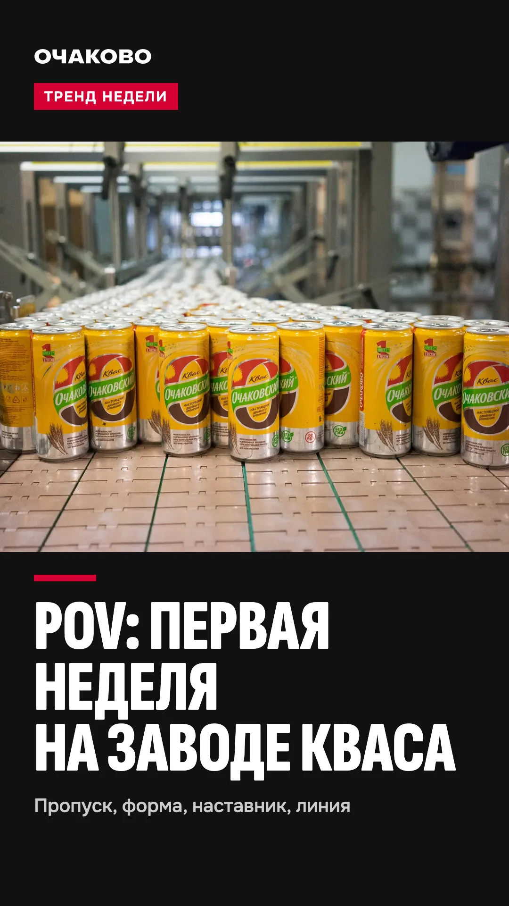

# Видеоролики о компании: короткие ролики на первый месяц

Документ для SMM-специалиста или мобилографа, отдела персонала и амбассадоров. Рубрики, площадки и ритм описаны в `docs/strategy.md`, §5, «Короткие ролики как главный канал охвата». Здесь расписано, что снимать в первые четыре недели, чтобы съёмка началась без лишних согласований.

## Коротко

- **Идея.** Вместо одного длинного ролика о компании делаем серию коротких вертикальных. Их смотрят там, где сидят 18–26 лет, каждый отвечает на один вопрос кандидата, и у каждого своя метка, поэтому видно, какой ролик привёл людей на смену.
- **Сколько.** 12 роликов за четыре недели, по три в неделю. Каждый длится 15–35 секунд, вертикаль 9:16.
- **Где.** Ролики выходят в VK Клипах. Тот же файл без переделки уходит в YouTube Shorts, Telegram-канал бота, MAX и Дзен.
- **Из чего.** Половину роликов можно смонтировать до съёмки: из роликов компании о профессиях, архивного фото и фирменной графики. Для остальных нужен один съёмочный день на заводе и два-три амбассадора.
- **Как считаем.** У каждого ролика своя метка: `?src=vk-clip-01` на сайт, `start=vk-clip-01` в бота. Метки заводятся во вкладке HR «Источники», заходы, заявки и выходы на смену по каждому ролику видны в «Воронке».
- **Правило.** Цифры берём только из материалов компании: «Описание практики», справочник студента, каталог. Суммы пишем со словами «от» и «до вычета налога». Условия не приукрашиваем.

## 1. Как устроен ролик

Формула одна для всех рубрик.

1. **В первые две секунды вопрос или цифра.** Текст на первом кадре до шести слов: «Сколько платят на заводе кваса», «Койко-место за 3 400 ₽». Человек решает, листать дальше или нет, по первому кадру.
2. **Дальше один факт.** В одном ролике одна мысль. Три факта подряд никто не запомнит.
3. **В конце куда идти.** Одна строка: «Посчитай свой заработок по ссылке в профиле» или «Спроси Квасыча в боте». Ссылка с меткой этого ролика.

Титры вшиваем в видео: в соцсетях смотрят без звука. Звук берём живой, шум цеха, или трек из библиотеки площадки: у таких треков есть права на использование внутри площадки. Шрифт титров тот же, что на сайте, цвета по брендбуку: красный `#D50032` и белый.

## 2. Сценарии

### Неделя 1: запуск

| № | Рубрика | Первый кадр | Что в кадре | Титры и факт | Куда ведёт | Что нужно |
|---|---|---|---|---|---|---|
| 01 | «Квасыч отвечает» | «Сколько платят на заводе кваса» | Квасыч с расчётным листом на телефоне, рядом по очереди всплывают роли | «Оператор линии розлива: от 70 000 ₽. Лаборант: от 60 000 ₽. Кладовщик: от 56 000 ₽. До вычета налога, смены по 12 часов» | «Собери лето» на сайте | поза `kvasych-money.png`; пока рисунка нет, карточки на красном фоне с пиктограммами |
| 02 | «Поймай брак» | «Найди брак за 3 секунды» | Линия розлива кваса, бутылки идут, одна без крышки. Стоп-кадр, круг вокруг брака | «Заметно сразу? Автомат видит такое за доли секунды. Операторы следят, чтобы он не ошибался» | игра «Поймай брак» на сайте | съёмка на линии кваса; черновик из ролика «Оператор линии розлива» |
| 03 | «Тогда и сейчас» | «Этот завод строили к Олимпиаде-80» | Архивный кадр комбината, переход на тот же вид сегодня | «Комбинат начал работу в 1978 году: ему поручили утолять жажду гостей Игр» | контрольные вопросы о компании, `/game?t=quiz` | `public/photos/archive-1978-480.webp`; новый кадр с той же точки |

### Неделя 2: как всё устроено

| № | Рубрика | Первый кадр | Что в кадре | Титры и факт | Куда ведёт | Что нужно |
|---|---|---|---|---|---|---|
| 04 | «Первый день» | «Что выдают в первый день» | Новичок надевает рабочую куртку, на спине «Я делаю натуральные напитки» | «Спецодежду и обувь выдают. Стирают в прачечной завода» | вакансия оператора линии розлива | ролик «Оператор линии розлива», 5–8 секунд, подпись ролика обрезать |
| 05 | «Квасыч отвечает» | «А если сессия?» | Квасыч смотрит на часы | «О зачёте или экзамене скажи руководителю заранее, и смену на это время не поставят. В сезон экзамены можно сдать прямо на территории завода» | бот, раздел «Практика» | поза `kvasych-clock.png` или карточки |
| 06 | «Сколько за лето» | Сумма крупно, как её называет человек | Практикант прошлого сезона в куртке у проходной, говорит в камеру своими словами: сколько получил, где жил, как добирался | Сумму пишем только ту, что человек называет по своему расчётному листу. Если в ней ночные смены, титр так и говорит: «с ночными сменами» | вакансии | амбассадор с письменным согласием; снимает на телефон |

### Неделя 3: быт

| № | Рубрика | Первый кадр | Что в кадре | Титры и факт | Куда ведёт | Что нужно |
|---|---|---|---|---|---|---|
| 07 | «Квасыч отвечает» | «Койко-место за 3 400 ₽» | Общежитие: кухня на этаже, комната, спортплощадка у входа | «Ул. Рябиновая, 36, к. 2. Для студентов 3 400 ₽ за койко-место. В комнате от 4 до 6 человек. Есть всё, кроме фена» | бот, вопрос про общежитие | съёмка в общежитии с разрешения коменданта, без жильцов в кадре |
| 08 | «Первый день» | «Лаборант: что делают руками» | Проба, анализ, записи в журнал | «Лаборант: от 60 000 ₽ до вычета налога. Смены 2/2 по 12 часов» | вакансия лаборанта | ролик «Химик-лаборант», 7–10 секунд; бокал на ножке и посторонние напитки кадрировать |
| 09 | Тренд недели | «POV: первая неделя на заводе кваса» | Быстрая нарезка: пропуск, турникет, форма, наставник у пульта, столовая | «Половину стоимости обеда платит компания. Деньги с собой не нужны» | сайт | съёмочный день; трек недели из библиотеки площадки |

### Неделя 4: люди

| № | Рубрика | Первый кадр | Что в кадре | Титры и факт | Куда ведёт | Что нужно |
|---|---|---|---|---|---|---|
| 10 | «Квасыч отвечает» | «Кто будет учить» | Квасыч у пульта показывает на экран | «Наставника прикрепляют к каждому новичку. Его учили в Учебном центре. На старте три шага: процессы, оборудование, работа на нём» | оплачиваемая практика на сайте | поза `kvasych-mentor.png` |
| 11 | «Тогда и сейчас» | «Что такое квас двойного брожения» | Бутылка кваса «Очаковский» на свету, затем линия розлива на ходу | «В 1996 году здесь впервые в промышленных масштабах воспроизвели двойное брожение кваса, молочнокислое и дрожжевое. С 1998-го выпускают квас „Очаковский“» | «Путь кваса» на сайте | съёмка линии кваса |
| 12 | «Наставник и новичок» | «Квас делают люди» | Настоящий наставник у пульта говорит одну фразу новичку, потом отходит на шаг | «Квас делают люди. К каждому новичку прикрепляют наставника» | заявка | наставник и практикант с письменным согласием; тот же съёмочный день, что для ролика о компании (`docs/brand/video.md`) |

### Когда начнётся сезон

С первыми практикантами появится рубрика, которую заранее не снять: «Первая неделя: как было». Практикант честно отвечает на тот же вопрос, что задаёт бот: что было тяжелее всего и кто помог. Темы берём из ответов «Как дела на смене» в «Воронке» (`docs/hr.md`): если чаще всего тяжело с дорогой, снимаем ролик про корпоративный автобус от м. «Озёрная». Так ролики отвечают на то, из-за чего новички уходят, и работают на 38% отсева из кейса.

## 3. Что снять за один съёмочный день

Ролики 02, 03, 07, 09, 11 и 12 снимаются за один выезд. Список кадров:

- линия розлива кваса: бутылки на ходу, автомат отбраковки, пульт;
- цех с той же точки, что архивный кадр 1978 года;
- проходная, турникет, раздевалка, столовая;
- общежитие: кухня, комната без жильцов, площадка у входа;
- наставник и практикант у пульта: одна фраза, затем наставник отходит на шаг;
- три-пять минут свободной съёмки на телефон у амбассадоров для «Сколько за лето» и тренда недели.

## 4. Чего не делаем

- В кадре только квас и безалкогольные напитки. Другие линии, их тара и этикетки в кадр не попадают.
- Суммы не округляем вверх и не выдаём частный случай за обычный. Сумму практиканта помечаем, если в ней ночные смены.
- Розыгрыши и челленджи у оборудования не снимаем: правила охраны труда в цехе важнее охвата.
- В кадре только взрослые: работа и практика с 18 лет.
- Квасыч не говорит за живых людей и не изображает сотрудника (`docs/kvasych.md`).

## 5. Сколько стоит

Деньги заложены в смете пилота (`docs/strategy.md`, §8, строка «Короткие ролики»). В неё входят работа SMM-специалиста или мобилографа и съёмочный день. Амбассадоры снимают на свои телефоны, рисунки Квасыча нужны те же, что для сайта, поэтому отдельных затрат на эти ролики нет.

## 6. Обложки и титры

Обложки всех 12 выпусков собраны в `docs/brand/clips/covers.html`, готовые файлы 1080 × 1920 для загрузки лежат в `docs/brand/clips/covers/clip-01.webp` и дальше по номерам. После правки их пересобирает `node scripts/clip-covers.mjs`.

- **Одна система.** Сверху знак и рубрика, в середине кадр, внизу вопрос первого кадра крупно и строка с фактом. Рубрику узнают по ленте до того, как прочитают текст.
- **«Квасыч отвечает».** Красная обложка без фото, с крупным знаком на фоне: «₽», «?», «36». Когда появятся рисунки Квасыча, он встаёт на место знака.
- **Кадры роликов компании** обрезаны так, чтобы их вшитые подписи не спорили с нашим текстом. Кадры лежат в `docs/brand/frames/`.
- **Зоны интерфейса.** На странице обложек есть переключатель «Показать зоны интерфейса VK Клипов»: текст обложки стоит вне мест, где лежат шапка, подпись и кнопки.
- **«Сколько за лето».** Это шаблон: сумму и кадр даёт герой выпуска, на обложке для них оставлено место.

Там же лежат шаблон титров (две строки по центру, белый текст на тёмной плашке) и финальная карточка с одним действием.

## 7. Референсы

| Референс | Что берём | Чего не берём | Источник |
|---|---|---|---|
| Ролики «Очаково» о профессиях | подписи-глаголы на «ты», красная плашка, наставник в кадре, надпись на спине | ролик «Процесс создания нового вкуса» и сцены с банками линии | `public/video/manifest.json`, исходники в `archive/case-materials/video/` |
| «Описание практики»: задача «один день из жизни студента» | формат: день глазами практиканта, снимают его студенты | — | «Описание практики» в `archive/case-materials/` |
| «Inside the Factory», документальный сериал BBC | производство шаг за шагом, крупные планы операций, рядом люди, которые их делают | ведущего-телезвезду: у нас говорят наставник и практикант | [Wikipedia](https://en.wikipedia.org/wiki/Inside_the_Factory) |
| «Северсталь», истории сотрудников на странице для студентов | человек рассказывает, с чего начинал в компании | длинные тексты вместо видео | [career.severstal.com](https://career.severstal.com/directions/graduates/) |
| «Мармеладыч» | короткие вертикальные ролики как основной канал: по словам основателя, «гораздо эффективнее, чем всякий таргетинг»; постоянные рубрики; юмор через персонажа (у нас это Квасыч) | абсурд ради охвата и приукрашенные условия: они расходятся с ценностями бренда «ответственный» и «искренний» | [Т—Ж](https://t-j.ru/marmeladich/) |
| X5, кампания «Карьера без срока годности» | посевы в карьерных и студенческих сообществах | ролик, сгенерированный нейросетью: в кадре должны быть настоящие люди и настоящий завод | [Sostav](https://www.sostav.ru/publication/x5-i-braining-group-zapustili-hr-kampaniyu-87481.html) |

## 8. Согласовать

- Съёмку в цехах, на проходной и в общежитии: дни, сопровождающий, правила гигиены цеха.
- Использование роликов компании о профессиях в нарезках.
- Письменное согласие каждого человека в кадре.
- Позы Квасыча для роликов 01, 05 и 10. Пока рисунков нет, эти ролики выходят карточками на фирменном фоне.
- Кто в отделе персонала отвечает на комментарии под роликами: вопросы оттуда станут темами следующих выпусков «Квасыч отвечает».
