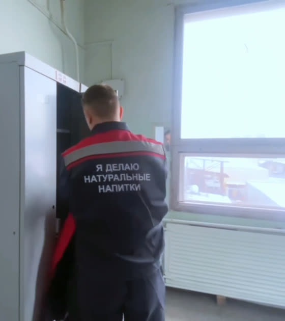
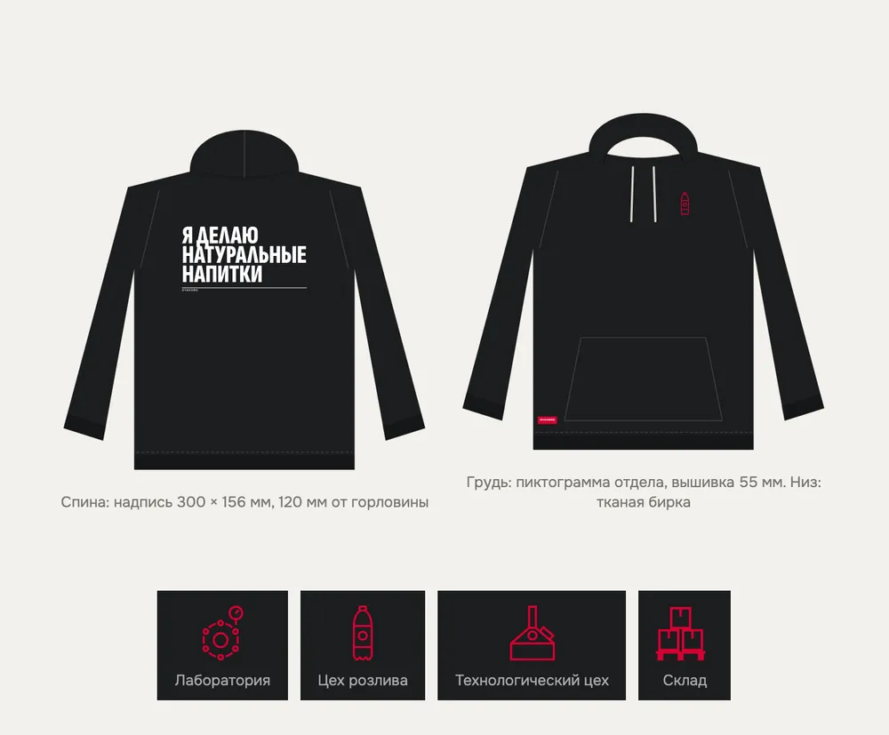
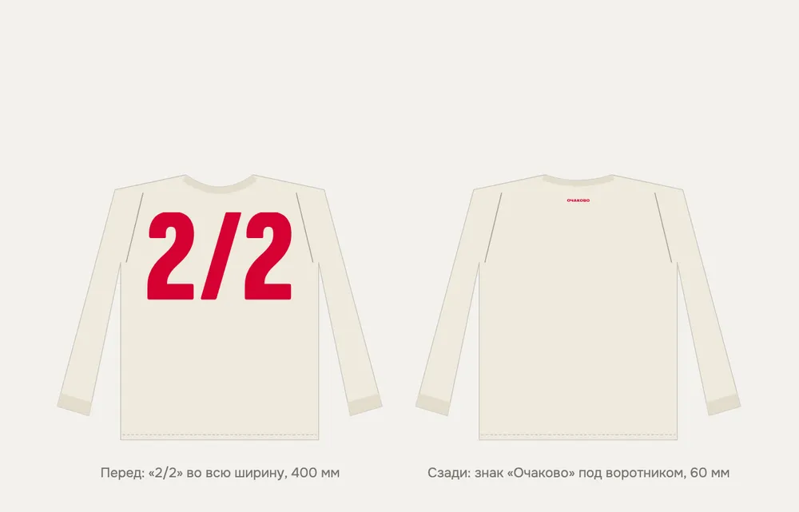
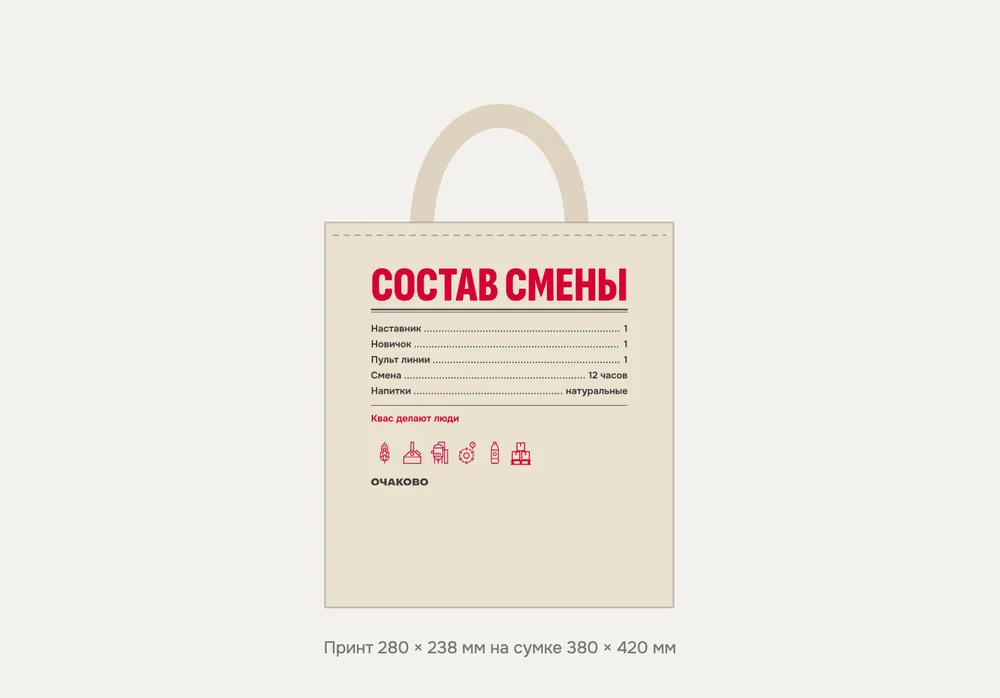
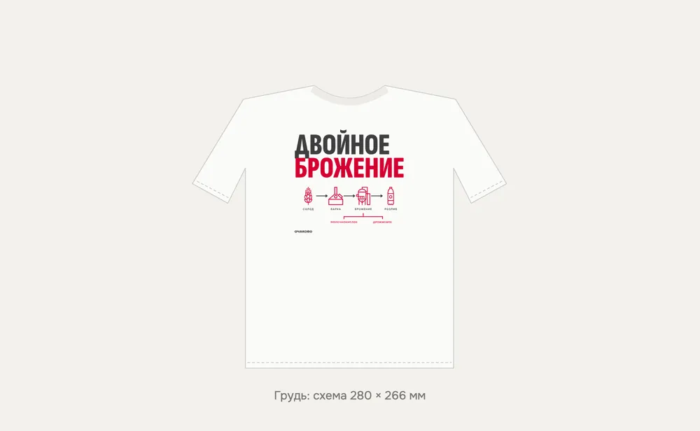
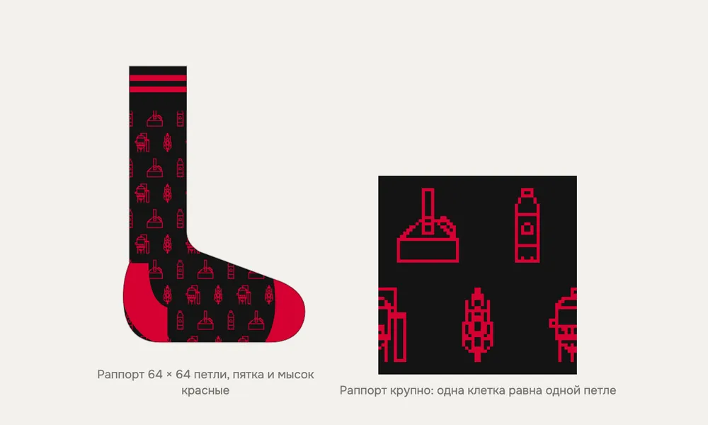
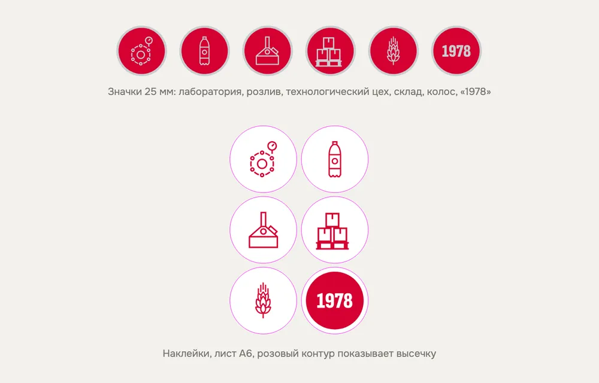

# Мерч: коллекция «Смена»

Документ для отдела персонала и руководства. Концепцию мерча по кейсу согласуют отдельно. Здесь описано, что носят и за что получают, как выглядят вещи и сколько это стоит. Технические рисунки изделий лежат в `docs/brand/merch/layouts.html`, файлы принтов для производства в `docs/brand/merch/art/`. Основа: концепция «Смена» (`docs/brand/concept.md`) и брендбук.

## Коротко

- **Идея.** Вещи, которые носят и после завода. На каждой есть то, что знают только свои: график «2/2», двойное брожение кваса, пиктограмма своего отдела, надпись со спины рабочей куртки. Логотип маленький: на бирке, под воротником, на ленте.
- **Почему так.** Корпоративный мерч уходит в шкаф, когда вещь нужна только для логотипа. Носят то, что не стыдно надеть на выходные ([Битрикс24](https://www.bitrix24.ru/journal/korporativniy-merch/), [vc.ru](https://vc.ru/marketing/1943156-merch-dlya-biznesa-5-prichin)). Для 18–26 лет решает качество: 90% готовы советовать бренды с хорошим мерчем ([PPAI](https://www.ppai.org/ppai-magazine/ppai-consumer-study-why-promo-clicks-with-gen-z/)).
- **Получают за шаг.** Значок «1978» дают за 6 верных ответов из 7 в викторине на сайте или в боте, значок и наклейку за контрольные вопросы на экскурсии и в музее, носки на стенде, ленту и значок отдела в первую смену, лонгслив через месяц на смене, худи после практики, шоппер, когда друг вышел на смену. Купить нельзя, за одну заявку не дают.
- **Главная вещь.** Худи «Я делаю натуральные напитки» с той же надписью, что на рабочих куртках. Его вручает наставник вместе с характеристикой, поэтому надпись правдива.
- **Цена.** Набор на 100 закончивших практику, 300 вышедших на смену, 20 амбассадоров, 20 наставников и сезон ярмарок стоит от 854 до 1413 тыс. ₽. Это ориентир команды, расчёт и минимальный набор для пилота в разделе 4.

## 1. Что отражает мерч

| Идея «Очаково» | Как это видно в мерче |
|---|---|
| «Натуральные — значит настоящие» (призвание из брендбука) | Надпись «Я делаю натуральные напитки» получает только тот, кто работал на заводе |
| Слоган концепции «Квас делают люди» | Слоган напечатан внутри горловины худи и на шоппере. Нашивку «Наставник» носят наставники Учебного центра |
| График 2/2 из «Описания практики» | Лонгслив: «2/2» во весь перед. Посторонним это ничего не скажет, а свои поймут сразу |
| История: двойное брожение кваса и комбинат 1978 года | Футболка амбассадора со схемой брожения, значок и наклейка «1978» в музее |
| Отделы практики | Пиктограмма своего отдела на груди худи и на значке: лаборатория, цех розлива, технологический цех, склад |
| Ценности: ответственный, доброжелательный, искренний, деятельный | Мерч выдают только за дело. Ценности на вещах не печатаем: смысл передаёт то, за что вещь получена |

## 2. Набор и за что его получают

| Предмет | За что | Что на нём | Кто выдаёт |
|---|---|---|---|
| Значки, коллекция из шести | контрольные вопросы (колос на экскурсии, «1978» в музее и за 6 из 7 в викторине на сайте); значок своего отдела за первую смену | пиктограммы четырёх отделов, колос, «1978»; красная эмаль и никель | гид экскурсии, музей, отдел кадров |
| Наклейки | контрольные вопросы на экскурсии, в музее и на стенде | те же шесть рисунков, круг 44 мм | гид, HR на стенде |
| Носки | все контрольные вопросы без ошибок на стенде ярмарки | жаккард: варочный котёл, бутылка, колос, танк брожения | HR на стенде |
| Лента с чехлом для пропуска | первая смена | знак «Очаково» и пиктограммы отделов белым на красной ленте | отдел кадров вместе с пропуском |
| Лонгслив | месяц на смене | «2/2» во весь перед, под воротником знак | отдел персонала после вопроса «Как дела на смене» через месяц |
| Шоппер «Состав смены» | приглашение друга: шоппер получает каждый из двоих, когда друг вышел на первую смену | «Состав смены» как состав на этикетке: наставник 1, новичок 1, пульт линии 1, смена 12 часов; ниже «Квас делают люди» | отдел подбора |
| Худи | законченная практика | на спине «Я делаю натуральные напитки» в три строки, как на рабочей куртке; на груди вышитая пиктограмма своего отдела; в горловине «Квас делают люди» | наставник, вместе с характеристикой |
| Футболка «Двойное брожение» | амбассадоры: в ней снимают короткие ролики | схема: солод, варка, брожение, розлив; молочнокислое и дрожжевое брожение | отдел персонала |
| Нашивка «Наставник» | обучение наставников в Учебном центре | «Наставник» и знак, нашивается на рабочую куртку | Учебный центр |

Правила выдачи:

- Худи не раздаём на ярмарках и не дарим гостям: иначе надпись на спине перестанет быть правдой.
- За заявку вещей не выдаём, иначе появятся заявки ради подарка. За друга вещь выдают, только когда друг вышел на смену. Это предложение команды: награду за друга компания ещё не утверждала, поэтому на сайте и в боте её пока нет.
- Лонгслив выдают через месяц на смене, в срок третьего вопроса «Как дела на смене» (`docs/hr.md`). Вещь отмечает, что самое трудное позади, и даёт отделу персонала повод поговорить с новичком лично.
- Значки собираются в коллекцию из шести: все шесть можно получить, только пройдя весь путь от экскурсии до смены.
- Значок «1978» за викторину на сайте забирают на стенде или на экскурсии, показав экран с итогом. Если человек подал заявку, HR видит в карточке «заработан значок «1978»» и выдаёт его в первый день.
- Пока выдачу отмечают заметкой в карточке кандидата в HR-панели («выдан значок», «выдано худи»). Если мерч утвердят, следующим шагом сделаем отдельное поле.

## 3. Как выглядит

Принципы:

- **Знак маленький.** Логотип стоит на тканой бирке худи, под воротником лонгслива, на ленте и шоппере. На груди и спине фраза или рисунок, ради которых вещь и надевают. Компании, у которых мерч носят, делают его на языке профессии: «Северсталь» вместе с брендом GRECHA одела в новую форму металлургов ([Sostav](https://sostav.ru/publication/severstal-i-grecha-83115.html)), «ВсеИнструменты.ру» собрали коллекцию для мастеров ([Sostav](https://www.sostav.ru/publication/delo-v-detalyakh-kak-vseinstrumenty-ru-razrabotali-kollektsiyu-mercha-dlya-professionalov-71405.html)).
- **Язык завода.** Только настоящее: график из «Описания практики», брожение из истории компании, пиктограммы оборудования из брендбука. Молодым нравятся логотипы и знаки с историей, ретро ценят выше футуристичного ([Morning Consult](https://pro.morningconsult.com/instant-intel/gen-z-millennial-logo-preferences)), поэтому в коллекции есть «1978».
- **Цвета.** Чёрный, натуральный небелёный хлопок и белый; красный `#D50032` идёт акцентом. Чёрное худи не путается с красными жилетами и куртками на производстве.
- **Плотные вещи.** Худи из футера 320–360 г/м², лонгслив и футболка 200–220 г/м², шоппер 220–280 г/м². Мелкий рисунок вышиваем, крупный печатаем шелкографией.
- **Шрифт.** Надпись на спине худи для тиража набирают шрифтом рабочих курток, чтобы худи и форма выглядели одной семьёй. В макетах стоят шрифты сайта и листовок.
- **Пиктограммы.** Не поворачиваем и не растягиваем, в группе один масштаб. Пиктограммы пивной тары и хмеля из набора исключены. Пиктограммы склада в брендбуке нет: её нарисовали по той же сетке 48 × 48 с той же толщиной линии (`docs/brand/merch/art/picto-warehouse.svg`), и её нужно согласовать.
- **Квасыч** на одежде не появляется: вещи говорят голосом сотрудника. Он остаётся в стикерпаке (`docs/kvasych.md`).

**Худи:** спина, перед и пиктограммы четырёх отделов на груди.

**Лонгслив:** «2/2» во весь перед, знак под воротником.

**Шоппер «Состав смены»** и **футболка «Двойное брожение»**.

**Носки** с пиктограммами, переведёнными в петли жаккарда, и **значки с наклейками**.

**Файлы для производства.** В `docs/brand/merch/art/` лежит каждый принт в натуральную величину, размеры в миллиметрах, текст переведён в кривые, поэтому подрядчику не нужны шрифты. У наклеек есть контур высечки CutContour, у носков сетка петель `socks-grid.txt`. Файлы собирает `scripts/merch-art.py` из шрифтов сайта и пиктограмм брендбука. Текст или размер правят в этом скрипте и запускают его заново.

## 4. Сколько стоит

Цены за штуку даны как ориентир команды для тиража от 100 штук: заготовка, печать или вышивка в один-два цвета. Это допущения: данных о закупках «Очаково» у нас нет, точную цену дают подрядчики по макетам и файлам из `docs/brand/merch/art/`.

| Предмет | Тираж на сезон | Ориентир за штуку | Ориентир на тираж |
|---|---|---|---|
| Значки, шесть видов | 1 000 | 70–140 ₽ | 70–140 тыс. ₽ |
| Наклейки, лист из шести | 1 000 листов | 30–60 ₽ | 30–60 тыс. ₽ |
| Носки | 300 пар | 250–400 ₽ | 75–120 тыс. ₽ |
| Лента с чехлом для пропуска | 300 | 150–300 ₽ | 45–90 тыс. ₽ |
| Лонгслив | 200 | 1 300–2 000 ₽ | 260–400 тыс. ₽ |
| Шоппер | 100 | 350–650 ₽ | 35–65 тыс. ₽ |
| Худи с вышивкой, печатью и тканой биркой | 100 | 3 000–4 800 ₽ | 300–480 тыс. ₽ |
| Футболка амбассадора | 40 | 900–1 300 ₽ | 36–52 тыс. ₽ |
| Нашивка «Наставник» | 20 | 150–300 ₽ | 3–6 тыс. ₽ |
| **Итого** | | | **от 854 до 1413 тыс. ₽** |

Тиражи тоже допущение: 300 человек вышли на смену, 200 доработали первый месяц, 100 закончили практику, 50 пар пришли по приглашению друга, 20 амбассадоров по две футболки, 20 наставников. Значки и наклейки рассчитаны на сезон экскурсий, музея и ярмарок.

Самые дорогие строки занимают худи и лонгслив, а их число зависит от того, сколько людей доработали первый месяц и практику до конца. Поэтому расход растёт, только когда растёт результат: на одного вышедшего на смену приходится от 2,8 до 4,7 тыс. ₽.

**Минимальный набор для пилота:** значки, наклейки, лента с чехлом и худи, от 445 до 770 тыс. ₽. Лонгслив, носки, шоппер и футболки добавляются, когда пилот покажет, сколько людей доходит до смены и до конца первого месяца.

Строка «Мерч и призы для стенда» в смете `docs/strategy.md` покрывает наклейки и мелочи для стенда. Остальной мерч считается отдельно, от числа людей на практике.

## 5. Чего не делаем

- Без пива, сидра, коктейлей, бокалов, открывашек и пивных пиктограмм: аудитория 18–26, закон «О рекламе».
- Логотип крупно не печатаем: вещь с большим логотипом носят только на корпоративе.
- Шутим только правдой: график и состав смены есть на самом деле. Без сленга и шуток про возраст коллектива.
- Год на вещах только исторический: 1978. Номера сезона нет: вещь носят дольше одного лета.
- Не выдаём мерч за заявку без выхода на смену и не обещаем его в рекламе как приз.
- Не заменяем мерчем спецодежду: на производстве носят только выданную форму и средства защиты.

## 6. Источники

- `docs/brand/concept.md`: идея, слоган, образ «Надпись на спине».
- `archive/case-materials/brandbook/_text.txt`: цвета, пиктограммы, паттерн, шеврон и платок среди носителей фирменного стиля (стр. 54 и 57).
- «Описание практики» (`docs/case.md`): график 2/2 «день — ночь — отсыпной — выходной», смены по 12 часов.
- `shared/content/company.ts`: 1978 год и двойное брожение кваса по каталогу компании.
- `public/video/manifest.json` и ролик «Оператор линии розлива»: надпись на спине рабочих курток.
- `archive/case-materials/handbook-text.txt`: пропуск и штраф 500 ₽ за потерю, наставник из Учебного центра, характеристика после практики.
- Почему мерч носят или бросают: [Битрикс24](https://www.bitrix24.ru/journal/korporativniy-merch/), [vc.ru](https://vc.ru/marketing/1943156-merch-dlya-biznesa-5-prichin).
- Молодёжь 18–26 и мерч: [PPAI](https://www.ppai.org/ppai-magazine/ppai-consumer-study-why-promo-clicks-with-gen-z/); логотипы с историей: [Morning Consult](https://pro.morningconsult.com/instant-intel/gen-z-millennial-logo-preferences).
- Мерч на языке профессии: [«Северсталь» и GRECHA](https://sostav.ru/publication/severstal-i-grecha-83115.html), [«ВсеИнструменты.ру»](https://www.sostav.ru/publication/delo-v-detalyakh-kak-vseinstrumenty-ru-razrabotali-kollektsiyu-mercha-dlya-professionalov-71405.html).

## 7. Согласовать с компанией

- Набор, бюджет и минимальный набор для пилота.
- Пиктограмму склада для значка, наклейки и груди худи.
- Награду за приглашение друга.
- Носки за контрольные вопросы на стенде ярмарки.
- Кто вручает худи и лонгслив и как это отмечают.
- Шрифт и цвет надписи на худи, как на рабочей форме.
- Подрядчика: тендер по макетам `docs/brand/merch/layouts.html` и файлам `docs/brand/merch/art/`.
