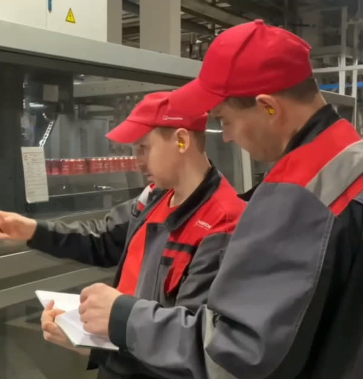
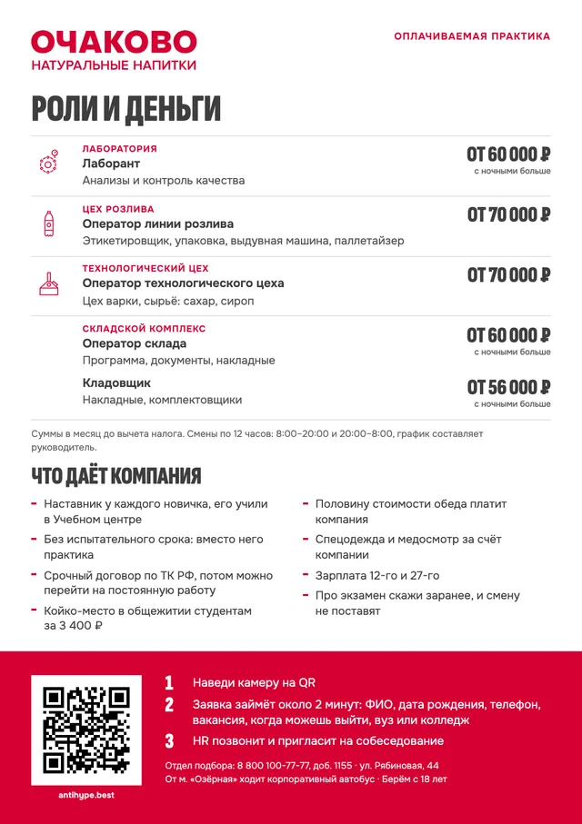
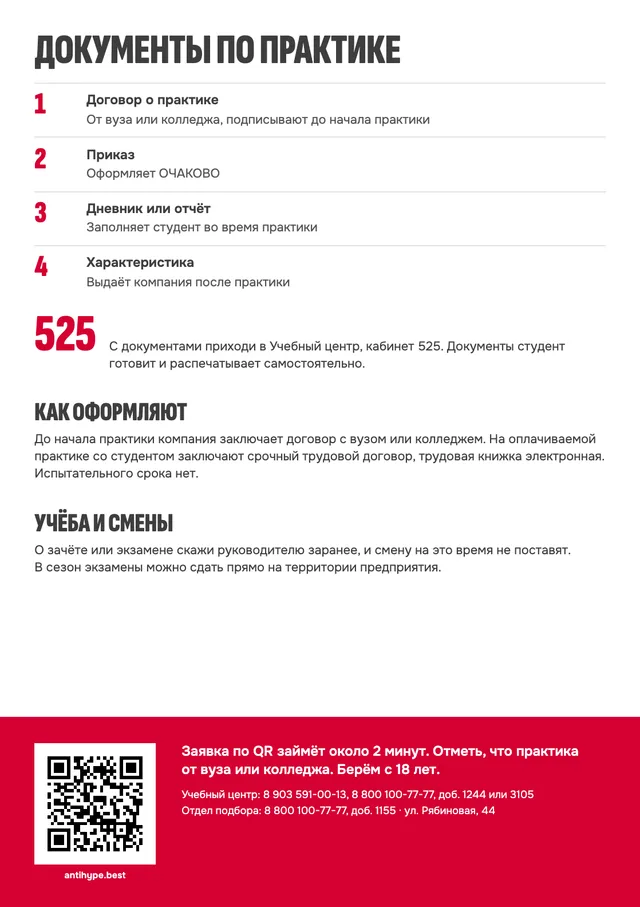
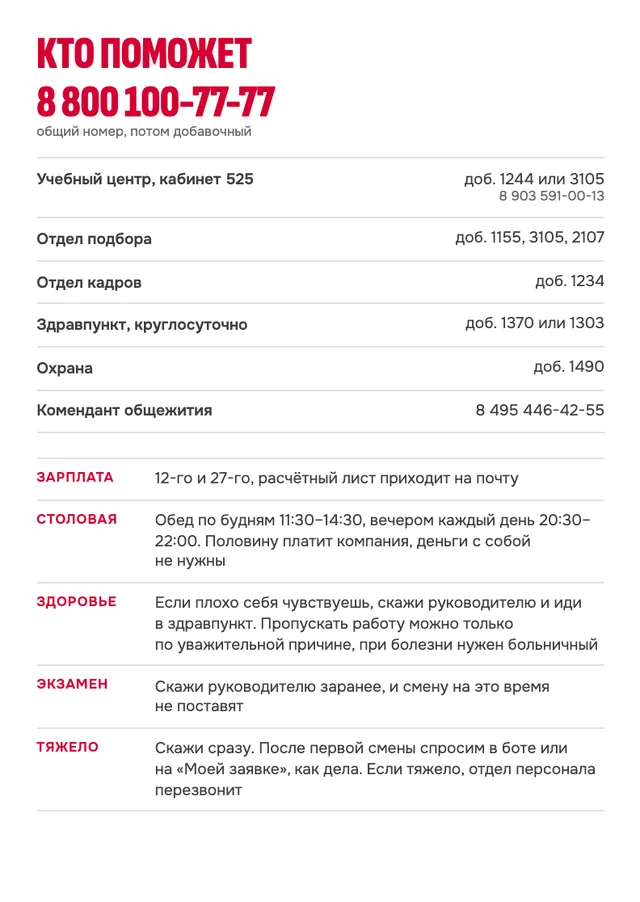

# Визуальные материалы: листовки, маскот, образы, референсы

Документ для отдела персонала, дизайнера и типографии. Всё здесь собрано вокруг концепции «Смена» из `docs/brand/concept.md`: слоган «Квас делают люди», ключевые образы, тон. По кейсу дизайн листовок согласуют отдельно, поэтому ниже готовые макеты для согласования, тексты и сетка.

## Коротко

- **Листовки.** Их три: A5 «Оплачиваемая практика» для экскурсий, музея, ярмарок, вузов и колледжей; A5 «Практика по договору с вузом» для центров карьеры и кафедр; A6 «Перед первой сменой» для тех, кого позвали на оформление.
- **Макеты.** Лежат в `docs/brand/print/`, открываются в браузере и печатаются в PDF. Вариант с вылетами для типографии открывается с `#bleed` в конце адреса. QR на метку источника делают в HR-панели, листовка A5 с QR печатается там же, на странице `/hr/poster`.
- **Маскот.** Квасыч, мастер-наставник. Позы и бриф художнику описаны в `docs/kvasych.md`. Рисунков пока нет.
- **Ключевые образы.** Сейчас это кадры из роликов компании. Для печати нужна новая съёмка по фотостилю «кто», список кадров в разделе 2.
- **Референсы.** У каждого есть источник и сказано, что берём и чего не берём.

## 1. Фирменный стиль на печати

| Элемент | Правило | Где взять |
|---|---|---|
| Логотип | Используем логотип без квадрата: красный на белом, белый на красном. Символ «квадрат с кругом» не используем. Вокруг логотипа оставляем свободное поле, паттерн ставим в другую часть листа | `public/brand/logo-red.svg`, `public/brand/logo-white.svg`, `public/brand/logo-line-red.svg` |
| Цвета | Основа: красный Pantone 199 (CMYK 0 100 75 0, `#D50032`) и белый. Тёмно-красный Pantone 7621 (`#AB2328`) идёт на пиктограммы и заливки на красном. Серый Pantone 429 (`#A2AAAD`) нужен для паттерна и заливок, текстом им не пишем. Текст набираем тёмно-серым Cool Gray 10 (CMYK 0 0 0 75) | брендбук, стр. 58 |
| Квас | Янтарный цвет бывает только у кваса на фото, заливок «под квас» не делаем | `docs/brand/concept.md`, образ «Квас на свету» |
| Пиктограммы | Одна толщина линий, в группе единый масштаб и цвет, без поворотов и отражений. Поле вокруг не меньше модуля. В группу собираем разные жанры: процесс, оборудование, сырьё, продукция. Пиктограммы пивной тары и хмеля из набора исключены | `public/brand/pictograms/manifest.json`, брендбук, стр. 50–51 |
| Пиктограммы отделов | У лаборатории «Контроль параметров», у цеха розлива «Бутылка ПЭТ», у технологического цеха «Варочный котёл». Для склада в наборе пиктограммы нет: пишем словами, новую пиктограмму может нарисовать автор набора по тем же правилам | `public/brand/pictograms/` |
| Паттерн | Для яркого фона. Геометрические фигуры всегда под пиктограммами. Паттерн не поворачиваем (кроме вещей без верха и низа, например платка). Ряды убираем только сверху, столбцы только слева, вокруг паттерна оставляем равное свободное поле | `public/brand/pattern-red.svg`, брендбук, стр. 52–54 |
| Квадратные модули | Лист делим не больше чем на 3 × 3 квадрата. Соседние модули можно объединять, у текста в модуле равное поле по периметру | брендбук, стр. 57 |
| Шрифт | По брендбуку нужен Proxima Nova, лицензия платная. В макетах стоят шрифты сайта: Sofia Sans Extra Condensed для заголовков и сумм, Onest для текста (лицензия OFL, `docs/brand/print/fonts/OFL.txt`). Перед тиражом компания решает: купить Proxima Nova или оставить шрифты сайта, чтобы листовка и сайт выглядели одинаково | брендбук, стр. 59 |
| Название | По брендбуку в тексте пишут ОЧАКОВО прописными и без кавычек, юридическое имя МПБК «ОЧАКОВО». На сайте и в боте сейчас «Очаково» в кавычках. В печатных макетах применено правило брендбука, окончательно решает компания | брендбук, стр. 61 |

## 2. Ключевые образы

Образы и смысл каждого описаны в `docs/brand/concept.md`, раздел 5. Здесь написано, откуда взять кадр сейчас и что снять для печати.

| Образ | Кадр сейчас | Где на носителях | Что снять для печати |
|---|---|---|---|
| 1. Наставник и новичок у пульта | ролик «Оператор линии розлива», около 18 с | лицевая листовки A5, ролик «Наставник и новичок» | двое у пульта линии: наставник показывает, новичок работает руками; лица видны, свет естественный; горизонтальный и вертикальный кадр |
| 2. Надпись на спине | тот же ролик, около 5 с и около 20 с | мерч, обложки соцсетей | спина рабочей куртки, надпись «Я делаю натуральные напитки» читается целиком, человек в работе |
| 3. Руки и детали | ролики «Химик-лаборант» и «Машинист оборудования» | карточки профессий, фон разделов | пульт, манометр, кнопка, рефрактометр, проба кваса, накладная на складе; без экранов с датами и чужими этикетками |
| 4. Квас на свету | `public/photos/hero-line-1600.webp`, `public/photos/products-1600.webp` | первый экран, полоса на листовке для вузов | бутылки кваса на линии, этикетка кваса читается; других напитков в кадре нет |
| 5. Тогда и сейчас | `public/photos/archive-1978-480.webp` | таймлайн, музей, соцсети | тот же цех с той же точки, что архивный кадр |
| 6. Квасыч | рисунков нет | сайт, бот, стикеры | рисует иллюстратор, раздел 4 |
| 7. Фирменные пиктограммы | `public/brand/pictograms/` | метки отделов на листовках, памятка A6 | — |

Кадры из роликов годятся для сайта, бота и черновых макетов. Для печати их мало: исходник 1280 × 720, на листовке A5 это меньше 150 точек на дюйм. Кроме того, в фоне кадра с пультом видны банки без читаемой этикетки, а на этой линии разливают не только квас. Поэтому для тиража нужна своя съёмка.

Правила съёмки:

- фотостиль «кто» из брендбука: естественный свет, рядом оборудование и детали спецодежды, в репортаже фокус на тех, кто в центре действия;
- в кадре только квас и безалкогольные напитки; линии и склады с другой продукцией не снимаем, этикетки проверяем покадрово;
- на людях в кадре средства защиты, которые положены в этом цехе (в цехе розлива, как в ролике, это беруши); съёмку согласуем со службой охраны труда;
- снимаем только тех, кто дал письменное согласие; имена и цитаты публикуем тоже с согласия;
- старый знак в квадрате на стенах и ёмкостях не ставим в центр кадра.

## 3. Листовки

### 3.1. A5 «Оплачиваемая практика»

**Зачем.** Это главная листовка набора. Её раздают на экскурсиях, в музее, на ярмарках, в вузах и колледжах. QR у каждой точки свой, поэтому HR-панель видит, откуда каждая заявка.

**Формат.** A5, 148 × 210 мм, двусторонняя, полноцвет с двух сторон. Вылеты по 3 мм, бумага мелованная матовая около 170 г/м² (уточняет типография).

**Печатная версия.** Макет `docs/brand/print/leaflet-a5.html` открывают в браузере и печатают в PDF. QR на метку источника делают в HR-панели, в разделе «Источники». Там же, на странице `/hr/poster` рядом с плакатом A3, листовка печатается сразу с QR по этим текстам и сетке.

**Сетка.** Поле от края до текста 8 мм, рабочее поле 132 × 194 мм. Модуль равен квадрату 44 мм, ровно три модуля в ширину, модули стыкуются без промежутков (брендбук, стр. 51 и 57).

- Лицевая. Сверху фото «Наставник и новичок у пульта» на 108 мм, под обрез с трёх сторон. Под ним один ряд модулей на всю ширину с красной заливкой и слоганом белым. Внизу белое поле: сумма, строка об отделах и сроках, справа «С 18 лет» и логотип.
- Оборот. Сверху логотип и «Оплачиваемая практика». Дальше «Роли и деньги»: строка на каждую роль, слева пиктограмма отдела, справа сумма. Под ними «Что даёт компания» в два столбца. Внизу красный модуль на всю ширину: место под QR 28 × 28 мм, три шага и контакты.

**Тексты лицевой стороны**

- Слоган: «Квас делают люди».
- Надзаголовок: «Оплачиваемая практика».
- Сумма: «от 56 000 до 70 000 ₽», под ней «в месяц до вычета налога».
- «Лаборатория, цех розлива, технологический цех, склад».
- «С начала марта или апреля до конца июля или середины августа».
- «С 18 лет».

**Тексты оборота**

| Отдел | Роль | Что делает | Сумма до вычета налога |
|---|---|---|---|
| Лаборатория | Лаборант | анализы и контроль качества | от 60 000 ₽, с ночными больше |
| Цех розлива | Оператор линии розлива | этикетировщик, упаковка, выдувная машина, паллетайзер | от 70 000 ₽ |
| Технологический цех | Оператор технологического цеха | цех варки, сырьё: сахар, сироп | от 70 000 ₽ |
| Складской комплекс | Оператор склада | программа, документы, накладные | от 60 000 ₽, с ночными больше |
| Складской комплекс | Кладовщик | накладные, комплектовщики | от 56 000 ₽, с ночными больше |

- Под таблицей: «Суммы в месяц до вычета налога. Смены по 12 часов: 8:00–20:00 и 20:00–8:00, график составляет руководитель».
- «Что даёт компания»: наставник у каждого новичка, его учили в Учебном центре; без испытательного срока, вместо него практика; срочный договор по ТК РФ, потом можно перейти на постоянную работу; койко-место в общежитии студентам за 3 400 ₽; половину стоимости обеда платит компания; спецодежда и медосмотр за счёт компании; зарплата 12-го и 27-го; про экзамен скажи заранее, и смену не поставят.
- Шаги: «Наведи камеру на QR». «Заявка займёт около 2 минут: ФИО, дата рождения, телефон, вакансия, когда можешь выйти, вуз или колледж». «HR позвонит и пригласит на собеседование».
- Контакты: «Отдел подбора: 8 800 100-77-77, доб. 1155 · ул. Рябиновая, 44. От м. „Озёрная“ ходит корпоративный автобус · Берём с 18 лет».

Срок звонка на листовке не пишем, пока отдел персонала его не утвердил. На сайте и в боте он есть, там его можно поменять без перепечатки.

### 3.2. A5 «Практика по договору с вузом»

**Зачем.** Для центров карьеры, кафедр и студентов 4-х курсов. Отвечает на вопросы, из-за которых практику не начинают: кто оформит договор, какие документы нужны, что делать с сессией. В основе посыл для 4-х курсов из `docs/brand/concept.md`, раздел 9.

**Формат.** A5, двусторонняя. Макет в `docs/brand/print/insert-vuz.html`. QR ведёт на метку вуза или колледжа; его делают в HR-панели, как для листовки 3.1.

**Сетка.** Те же поля и модуль 44 мм.

- Лицевая. Сверху красный блок на два модуля: логотип и главный посыл. Ниже два столбца, «Оплачиваемая» и «Бесплатная». Внизу полоса 30 мм под обрез с фото кваса «Семейный секрет».
- Оборот. «Документы по практике» в четыре строки с номерами. Ниже крупно «525» и куда идти. Дальше «Как оформляют» и «Учёба и смены». Внизу красный модуль с QR и контактами.

**Тексты**

- Заголовок: «Практика по договору с вузом, с зарплатой и без испытательного срока».
- «Оплачиваемая»: «от 56 000 до 70 000 ₽ в месяц до вычета налога». Лаборатория, цех розлива, технологический цех, склад. С начала марта или апреля до конца июля или середины августа. Срочный трудовой договор, наставник у каждого новичка.
- «Бесплатная»: «В разных отделах по договорённости, без оплаты. Например:», дальше в паре с инженером технической поддержки; оцифровка производственной линии; план оптимизации производства; взятие проб на контроль качества; ролики о профессиях и электронный курс. Полный список задач есть в «Описании практики».
- «Документы по практике»: 1. Договор о практике от вуза или колледжа, подписывают до начала практики. 2. Приказ, оформляет ОЧАКОВО. 3. Дневник или отчёт, заполняет студент во время практики. 4. Характеристика, выдаёт компания после практики.
- «С документами приходи в Учебный центр, кабинет 525. Документы студент готовит и распечатывает самостоятельно».
- «Как оформляют»: «До начала практики компания заключает договор с вузом или колледжем. На оплачиваемой практике со студентом заключают срочный трудовой договор, трудовая книжка электронная. Испытательного срока нет».
- «Учёба и смены»: «О зачёте или экзамене скажи руководителю заранее, и смену на это время не поставят. В сезон экзамены можно сдать прямо на территории предприятия».
- Внизу: «Заявка по QR займёт около 2 минут. Отметь, что практика от вуза или колледжа. Берём с 18 лет». Учебный центр: 8 903 591-00-13, 8 800 100-77-77, доб. 1244 или 3105. Отдел подбора: 8 800 100-77-77, доб. 1155.

### 3.3. A6 «Перед первой сменой»

**Зачем.** Памятку дают на собеседовании или при оформлении. Кейс называет 38% отсева на испытательном сроке, а честное «что тебя ждёт» до первой смены снимает часть неожиданностей. Факты взяты из справочника студента, но здесь они уложены в одну карточку, которая помещается в карман.

**Формат.** A6, 105 × 148 мм, двусторонняя. Макет в `docs/brand/print/first-shift-a6.html`. QR нет: человек уже в процессе найма.

**Сетка.** Поле 6 мм. Лицевая: красная шапка 30 мм с заголовком и логотипом, ниже строки с меткой слева и текстом справа. Внизу группа из шести фирменных пиктограмм разных жанров, модули стыкуются без промежутков. Оборот: «Кто поможет» с общим номером крупно, таблица добавочных и строки о деньгах, столовой, здоровье, учёбе и о том, что делать, если тяжело.

**Тексты лицевой стороны**

- «До смены»: медосмотр за счёт компании, договор и инструктаж по охране труда.
- «Одежда»: спецодежду и обувь выдают. Стирают в прачечной завода по будням 8:30–16:30.
- «Пропуск»: в отделе кадров. Если потерялся, новый выдадут за штраф 500 ₽.
- «Дорога»: от м. «Озёрная» ходит корпоративный автобус. Городские: 275 и 610 от м. «Кунцевская», 259 от станции «Рабочий посёлок», 259, 275 и 221 от м. «Говорово».
- «Общежитие»: ул. Рябиновая, 36, к. 2. Заезд до 14:00 или после 16:00, ключи у коменданта. Вход закрыт с 23:00 до 6:00. Фен взять с собой.
- «Наставник»: его прикрепляют к каждому новичку. На старте: освоить процессы, освоить оборудование, работать на нём.

**Тексты оборота**

- «Кто поможет»: общий номер 8 800 100-77-77, потом добавочный. Учебный центр, кабинет 525: доб. 1244 или 3105, 8 903 591-00-13. Отдел подбора: доб. 1155, 3105, 2107. Отдел кадров: доб. 1234. Здравпункт, круглосуточно: доб. 1370 или 1303. Охрана: доб. 1490. Комендант общежития: 8 495 446-42-55.
- «Зарплата»: 12-го и 27-го, расчётный лист приходит на почту.
- «Столовая»: обед по будням 11:30–14:30, вечером каждый день 20:30–22:00. Половину платит компания, деньги с собой не нужны.
- «Здоровье»: если плохо себя чувствуешь, скажи руководителю и иди в здравпункт. Пропускать работу можно только по уважительной причине, при болезни нужен больничный.
- «Экзамен»: скажи руководителю заранее, и смену на это время не поставят.
- «Тяжело»: скажи сразу. После первой смены спросим в боте или на «Моей заявке», как дела. Если тяжело, отдел персонала перезвонит. Так памятка связана с «Как дела на смене» (`docs/hr.md`): человек заранее знает, что его спросят и что «тяжело» тоже нормальный ответ.

### 3.4. Стенд на ярмарке: ролл-ап и табличка на стол

**Зачем.** Ярмарки, вузы и экскурсии дают основной поток профильных кандидатов (`docs/strategy.md`, раздел 5). У стенда человек решает за несколько секунд, подходить или нет, поэтому ролл-ап отвечает на главные вопросы издалека: что за работа, сколько платят, кто научит, как откликнуться.

**Ролл-ап 850 × 2000 мм** лежит в `docs/brand/stand/rollup.html`. Раскладка идёт по высоте от пола. На уровне глаз, на 1500–1850 мм, стоит красный блок: знак, пиктограммы и сумма оплачиваемой практики крупным шрифтом. Посередине QR 250 мм на высоте 1050–1300 мм, чтобы навести телефон, не нагибаясь, «Заявка за 2 минуты» и фото наставника с новичком, под ним слоган «Квас делают люди». Ниже 700 мм только подробности для тех, кто подошёл: наставник, смены, общежитие, автобус от м. «Озёрная». Нижние 150 мм уходят в основание, туда ничего не ставим. Фото пока черновое, из ролика компании; для тиража нужна съёмка наставника и новичка, исходник не меньше 3400 px по ширине.

**Табличка на стол A4** лежит в `docs/brand/stand/table-tent.html`. Лист сгибается домиком. Сторона к посетителю: «7 вопросов о заводе кваса» и носки за ответы без ошибок, QR ведёт на контрольные вопросы с меткой ярмарки. На стороне к сотруднику шпаргалка: как вести человека у стенда, что говорить о деньгах и быте, что делать, если не знаешь ответа. Носки за вопросы предложены в `docs/brand/merch.md`, до утверждения на табличке ставят наклейку.

### 3.5. Как печатать и обновлять

- Открыть макет в Chrome, «Печать» → «Сохранить как PDF», поля «Нет», «Фон» включён. Для типографии нужен тот же адрес с `#bleed`: фон уйдёт в вылеты по 3 мм, вокруг появится поле 6 мм с метками реза, страница станет 166 × 228 мм (для A6 123 × 166 мм). У ролл-апа с `#bleed` вылеты по 5 мм, лист 872 × 2022 мм; у таблички 228 × 315 мм.
- В макетах стоят демо-QR на демо-адрес сайта с демо-метками, их делает `scripts/materials-qr.ts`. Перед тиражом QR с меткой своей точки берём в HR-панели, вкладка «Источники», и ставим на их место. Минимальный размер QR 28 мм, вокруг белое поле.
- Суммы и условия меняются в `shared/content/`. При любой правке там суммы, роли и телефоны на листовках сверяют с сайтом заново.
- Тираж и бумагу согласует отдел персонала. Дизайн листовок по кейсу утверждают отдельно.

## 4. Маскот: Квасыч

**Роль.** Квасыч, мастер-наставник, это собирательный образ опытных сотрудников, которых обучили в Учебном центре и которые учат новичков (`docs/brand/concept.md`, раздел 8). На сайте и в боте он проводник: подсказывает, где что, и отвечает на вопросы. За настоящего наставника себя не выдаёт.

**Внешность и позы.** Описаны в `docs/kvasych.md`: пышные усы, красная рабочая куртка, 14 поз с именами файлов, файлы кладутся в `public/mascot/`. Для печати и мерча новых поз не нужно. Рядом с QR стоит поза «показывает» (`kvasych-point.png`), на аватаре бота и стикерах «лицо» (`kvasych-face.png`), в приветствии «машет» (`kvasych-hello.png`).

**Правила**

- В руках только квас.
- На печатном носителе не больше одного Квасыча. Он стоит в нижней части листа рядом с QR или подсказкой и не выше 40 мм на A5.
- На обложку вместо людей не ставим: главными героями кампании остаются настоящие наставники и практиканты.
- Слоганом не говорит. Его реплики короткие, до 10 слов, по `docs/quality-brief.md`, к собеседнику он обращается в нейтральном роде.
- Не шутит про возраст коллектива, деньги и алкоголь. Не обещает конкретного наставника и удобный график.
- Цвета берём из брендбука и `docs/kvasych.md`, линия одной толщины во всех позах, как у фирменных пиктограмм.

**Что есть сейчас.** Рисунков нет: папка `public/mascot/` пустая, сайт без них Квасыча не показывает. Кто нарисует, решает компания. Это может быть иллюстратор по брифу или студент на бесплатной практике: в «Описании практики» среди задач есть «маскоты для странички студента». Порядок такой: сначала три позы для старта («машет», «показывает», «лицо»), потом остальные. Из готовых поз сразу нарезается стикерпак для Telegram и MAX.

## 5. Референсы

| Референс | Что берём | Чего не берём | Источник |
|---|---|---|---|
| Справочник студента «Очаково» | формат A5, вопрос и ответ, настоящие адреса и добавочные номера | рисованных персонажей вместо сотрудников: листовке набора по фотостилю «кто» нужны настоящие люди | справочник студента в `archive/case-materials/`, текст в `archive/case-materials/handbook-text.txt` |
| Каталог продукции «Очаково» | красная заливка и белый, крупный заголовок, фото производства на полосе | круглые плашки под пиктограммы: по брендбуку пиктограмма стоит в квадратном модуле | `archive/case-materials/history/Снимок2.PNG` |
| Брендбук: модули, паттерн, фотостиль | квадратный модуль 3 × 3, правила паттерна, категории фото «кто» и «как» | макеты из брендбука, где показаны другие напитки компании | `archive/case-materials/brandbook/_text.txt` |
| Ролики компании о профессиях | подписи-глаголы («Надень форму», «Наставники всегда помогут»), красная плашка подписи, люди в кадре | прежний знак в квадрате на заставке, сцены с алкогольной продукцией | `public/video/manifest.json` |
| X5, кампания «Карьера без срока годности» | QR там, где бывают студенты, роудшоу по вузам и колледжам, кадровый резерв из регистраций, замер узнаваемости до и после | сленговые названия профессий и картинки, сделанные нейросетью: они расходятся с тоном и фотостилем «кто» | [Sostav](https://www.sostav.ru/publication/x5-i-braining-group-zapustili-hr-kampaniyu-87481.html) |
| «Северсталь», страница для студентов | четыре шага «Как попасть на практику», истории тех, кто начал карьеру в компании, вопросы и ответы | формулу «оплата зависит от направления»: у «Очаково» суммы известны, их и пишем | [career.severstal.com](https://career.severstal.com/directions/graduates/) |

Аналоги шире (программы стажировок, «Мармеладыч», лендинг «Боржоми») разобраны в `docs/analytics.md`.

## 6. Согласовать с компанией

- Дизайн листовок, тираж и бумагу.
- Шрифт для тиража: Proxima Nova по лицензии или шрифты сайта.
- Написание названия на печати: ОЧАКОВО по брендбуку или «Очаково», как на сайте.
- Съёмку: цеха, героев, согласия на фото и имена.
- Кто рисует Квасыча и в какие сроки.
